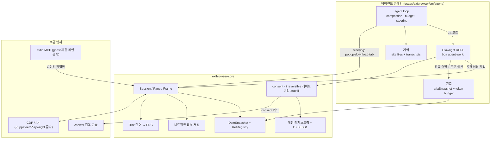

# Agent-first browser — OxiBrowser 재설계 (2026-10-16)

> 기준 문서: Aside의 설계 테제(aside.com/blog "How we built a browser agent that outperforms
> Fable", 2026-06)를 OxiBrowser 자산에 대입해 **에이전트를 1차 사용자로** 재설계한다.
> Aside는 폐쇄 소스 Chromium 포크다. 우리는 같은 원리를 순수 Rust 엔진 위에, 헤드리스·임베디드
> 형태로 구현한다.

## 1. 전제: Aside에서 취할 것, 버릴 것

Aside의 입증된 테제:

1. **에이전트는 코딩 에이전트다.** 핵심 도구는 REPL + bash. 에이전트는 Playwright 문법의
   JS를 *작성*한다. 전용 browser-control 툴셋(snapshot/click/fill 조합)을 쓰지 않는다.
2. **모델의 학습 분포를 따른다.** LLM이 가장 많이 본 브라우저 API는 Playwright. 시스템
   프롬프트는 Playwright를 가르치지 않고 "Playwright가 사용 가능하다"만 말한다(10K 토큰 이하).
3. **컨텍스트 창이 성능의 병목이다.** 저신호 도구 출력(DOM, 원시 CDP)은 모델을 망친다.
   토큰 효율 커스텀 a11y 트리(경쟁 대비 ~70% 축소)가 기본 관측이다.
4. **로그인 계정을 직접 쓴다.** 통합/API 글루 없이. 자격증명은 모델에게 절대 노출되지
   않는 autofill로 주입되고, 민감 행동은 사람 승인을 기다린다.
5. **실제 브라우저라 봇으로 탐지되지 않는다.** 에이전트 탭은 포커스를 뺏지 않고 뷰포트는
   고정(1440×900)이며, 팝업/다운로드/탭 종료 같은 비동기 신호가 에이전트에게 steering로
   전달된다.
6. **폴백 사다리.** DOM 로케이터 → 사이트 내부 API 역설계·재생 → 스크린샷 CUA.

버릴 것(우리 제약과 충돌):

- Chromium 포크, GUI 윈도우, GPU 컴포지터 — 기존 비목표 유지.
- 폐쇄 소스 하니스 — 우리는 엔진과 하니스가 같은 저장소·같은 프로세스.

**우리에게 주는 구조적 이점:** Aside의 REPL은 Chromium 밖 Node에서 CDP를 타고 들어온다.
OxiBrowser는 하니스가 엔진 안에서 실행된다. 와이어 프로토콜 마셜링이 없고, 안전 게이트를
API 밑 엔진 경계에서 강제할 수 있다.

## 2. 핵심 반전

오늘: 엔진 + (CDP/MCP라는) 원격 조종 포트. 에이전트는 밖에 산다(Puppeteer 클라,
MCP 호스트, ghost 슈퍼바이저).

재설계: **브라우저가 에이전트의 워크스테이션이다.** 하니스 루프, 관측, 신원, 기억, 감독이
전부 브라우저 내장 기관이다. CDP와 MCP는 호환 엣지로 강등된다.

```
[ 모델 클라이언트 ]   ← bring-your-own-key (키체인 저장)
[ 에이전트 루프 ]     ← REPL + bash, compaction, steering 이벤트, 예산
[ Oxiwright REPL ]   ← Playwright 문법, boa agent-world에서 실행
[ 관측 / 신원 / 감독 / 기억 ]  ← ariaSnapshot, 계정+autofill, viewer, site files
[ 엔진 (core) ]      ← 안전 게이트(consent·irreversible)는 여기서 강제
[ CDP / MCP / CLI ]  ← 호환 엣지 (1차 인터페이스 아님)
```

## 3. 아키텍처



배치: REPL의 agent-world는 boa `Context`가 `!Send`이므로 전용 스레드. 페이지 JS 스레드와는
기존 fetch/localStorage/DOM 브리지와 같은 mpsc 채널 패턴으로 통신한다(새 패턴 아님).
모델 클라이언트는 비동기 런타임 쪽에 둔다.

크레이트 계획: 하니스는 먼저 `crates/oxibrowser/src/agent/` 모듈(bin 크레이트에 session/mcp가
이미 있는 패턴). 5-크레이트 비목표 유지. oxios가 라이브러리로 임베드할 단계가 오면
`oxibrowser-agent`로 승격 — 그때 비목표를 명시적으로 수정한다.

## 4. 프리미티브 설계

### 4.1 Oxiwright REPL — 1차 인터페이스

- **API 표면은 Playwright와 동일하게**: `page.goto()`, `page.getByRole/getByText/
  getByLabel`, `locator.click()/fill()/press()`, `page.screenshot()`, `expect(locator)`
  대기체. 구현은 네이티브(엔진 직접 호출)이고 얇게.
- **보증은 API 밑에서**: `locator.fill()`이 password 컨트롤에 닿으면 값은 자격증명
  브로커가 엔진 안에서 주입(모델 컨텍스트에 비밀 없음). `locator.click()`은 불가역
  패턴 게이트를 통과한다(기존 `OXI.clickRef`/`fillRef` 강제 지점과 동일 경로).
  로케이터 해석은 DomSnapshot + RefRegistry 기반이라 stale-ref 무효화·재관측 규칙이
  그대로 계승된다.
- **프롬프트 규율**: 시스템 프롬프트+도구 정의 합산 예산 상한(목표 10K 토큰).
  Playwright를 설명하지 않는다. `skill`/`describe` 체계를 에이전트 모드로 확장.

### 4.2 관측 — 토큰 예산 a11y 스냅샷

- 기본 관측은 Playwright `ariaSnapshot` 형식(YAML) + focus/iframe/clickable 주석.
  ghost 모드가 이미 만든 a11y 트리·64개 실행 가능 요소·ref 스코핑·truncation 보고를
  일반화한다.
- `observe(tab, { budgetTokens })`: 응답 크기를 토큰 예산으로 선언적으로 제어.
- 스냅샷 generation이 이미 있으니 diff 갱신으로 연속 관측 비용 절감.

### 4.3 신원 — 이미 가장 강한 자산

계정 레지스트리 + AEAD 봉투(OXSESS1) + 그랜트/`account exec` + per-account flock이
Aside 테제 4의 구현체다. 보강점:

- REPL에 `page.login('github')` 수준의 오케스트레이션(로그인 마커·봇 벽 메모는 4.5
  site file에서).
- LLM API 키도 같은 키체인/브로커로 저장 — 브라우저가 자기 하니스의 비밀을 스스로
  관리한다.

### 4.4 감독 — /viewer를 사이드바로

- viewer(스크린캐스트 미러 + 확인 카드)가 Aside 사이드바의 헤드리스 등가물.
- ghost-handoff의 소유권 상태 기계(사람 epoch, 재개 후 재관측 강제)를 일반 에이전트
  모드로 확장: 사람이 일시정지·인수·재개 가능.
- 에이전트 탭은 논리 뷰포트 1440×900 고정(CUA 학습 분포 + 재현성). viewer 미러와
  무관하게 레이아웃이 흔들리지 않는다.

### 4.5 기억

- **site file**(origin 단위): 검증된 셀렉터, 로그인 마커, 발견된 내부 API 엔드포인트,
  봇 벽 특성. 구조화 파일 + 전문 검색으로 시작, 임베딩은 나중.
- **transcript**: 작업 로그(OXSESS + audit JSONL 이미 있음)를 재생 가능 기억으로 —
  `task resume`은 마지막 관측부터 재개.

### 4.6 하니스 품질

- **steering 이벤트**: 팝업 열림/다운로드 시작/탭 종료/dialog를 REPL 이벤트 큐로 push.
  CDP 이벤트는 이미 있으니 표면만 추가.
- **폴백 사다리**: 로케이터 실패 → 네트워크 캡처로 사이트 API 역설계 후 in-page
  `fetch()` 재생(동일 지문이라 봇 플래그 없음) → vello_cpu PNG + CUA. 네트워크 스택과
  렌더러가 이미 있다.
- **두 레인 원칙**: 전력 레인(신뢰된 에이전트, REPL+bash)과 제한 레인(ghost: eval 없음,
  스냅샷 바인딩 ref만). ghost의 "no eval"은 비신뢰 슈퍼바이저용 계약으로 그대로 유지되고,
  에이전트 플레인은 그 위에 강력한 레인을 추가한다.

## 5. 자산 매핑

| Aside 테제 | OxiBrowser 현자산 | 갭 |
|---|---|---|
| 코딩 에이전트 REPL | session REPL(JSON 명령), boa | agent-world + Playwright DSL |
| 토큰 효율 관측 | a11y 트리, ref, markdown, truncation 보고 | ariaSnapshot 형식, 토큰 예산 파라미터 |
| 계정 직접 사용·비밀 미노출 | 레지스트리, OXSESS1, 그랜트, consent 게이트, redaction | REPL 통합 autofill |
| 사람 승인 | viewer 확인 카드, exit 5 CONSENT_REQUIRED | 루프 안 대기·알림 |
| 봇 회피 | wreq 지문, stealth surface | 유지 |
| 고정 뷰포트·배경 탭 | 헤드리스(구조적으로 무포커스) | 논리 뷰포트 고정 규칙화 |
| steering 이벤트 | CDP 이벤트 12 도메인 | REPL 이벤트 큐 |
| 사이트 API 역설계 | 네트워크 스택, in-page fetch | 캡처→재생 도구 |
| CUA 폴백 | Blitz 렌더, PNG | 좌표 클릭 결합 |
| 자기조직 기억 | OXSESS, audit JSONL | site file, resume |
| 하니스 루프 | 없음(외부: oxios, ghost 슈퍼바이저) | 신규 — 본 설계의 주요 신규물 |

## 6. 역할 재정의

- **CDP**: 유지하되 강등. Puppeteer/Playwright 클라 상호운용 엣지. 에이전트 1차
  인터페이스 아님(Aside 테제: "CDP는 에이전트에게 나쁜 선택").
- **stdio MCP**: 외부 호스트·ghost 제한 레인 유지.
- **WebDriver BiDi**: 로드맵 우위를 낮춰 에이전트 플레인 뒤로.
- **CLI**: `oxibrowser agent`가 새로운 최상위 명령(모델 키는 `credential`/`account`
  체계로). `fetch`/`session`/`serve`는 그대로.

## 7. 단계

| 단계 | 내용 | 완료 기준 |
|---|---|---|
| P0 | agent-world(boa) + Playwright 로케이터 서브셋 + ariaSnapshot 관측 | REPL에서 `getByRole().click()`이 게이트 통과해 동작; 스냅샷이 예산 내 출력 |
| P1 | 에이전트 루프(모델 클라이언트 trait, compaction, steering) + viewer 카드를 루프에 연결 | 로컬 모델로 3-스텝 작업 자율 완료; consent에서 대기·재개 |
| P2 | site file + `task resume` + 네트워크 캡처→API 재생 도구 | 같은 작업 2회 실행 시 2회째 관측/단계 수 감소 실측 |
| P3 | CUA 폴백(고정 뷰포트) + 내부 과업 코퍼스 평가 | 로케이터 불가 페이지에서 좌표 클릭 성공; 코퍼스 통과율 리포트 |

평가는 로드맵 2번(공개 호환 벤치마크)과 병행 — 하니스 품질은 코퍼스 통과율로만 말한다.

## 8. 열린 질문

1. REPL 실행 컨텍스트의 샌드박스 강도 — 전력 레인에서 `bash`를 어디까지 줄 것인가
   (작업 디렉터리 한정? 호스트 전체?). Aside는 무제한에 가깝다.
2. 모델 클라이언트 범위 — OpenAI 호환 + Anthropic 우선, 로컬(MLX 서버)은 설정으로.
3. site file의 공유 단위 — 로컬-only로 시작, 저장소 커뮤니티 공유는 나중(프라이버시
   경계 먼저).
4. ghost 레인과 전력 레인의 설정 전환 — 플래그 하나(`--trust full|restricted`)인지
   별도 바이너리 경로인지.
