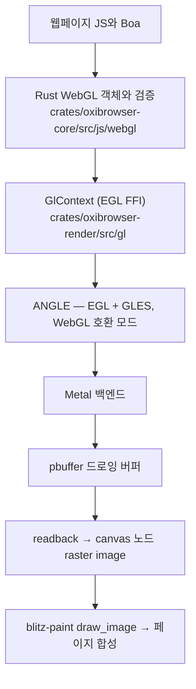

# WebGL via ANGLE — implementation design

작성일: 2026-10-25
근거 연구: [`docs/research/2026-10-25-webgl-open-source.md`](../research/2026-10-25-webgl-open-source.md)
상태: 구현 (milestone 1–4 경로 완성, Metal 백엔드 교체 이슈 진행 중 — 아래 "백엔드 상태" 참조)

## 요약

Boa용 WebGL 프런트엔드(Rust) + ANGLE 실행 백엔드 + readback 합성. 연구 보고서의 제안 경로를 그대로 따른다.

## 레이어와 파일

| 계층 | 위치 | 역할 |
|---|---|---|
| GL 백엔드 | `crates/oxibrowser-render/src/gl/{mod.rs,egl.rs}` | EGL 1.5 FFI(ANGLE 상수는 chromium/8118 헤더에서 전사), 프로세스당 1 display(`EGL_PLATFORM_ANGLE_TYPE_METAL_ANGLE`), 캔버스당 context+pbuffer, WebGL 호환/robust-init 속성, readback(top-down 변환, present 시 clear), resize(surface 재생성) |
| 프런트엔드 레지스트리 | `crates/oxibrowser-core/src/js/webgl/mod.rs` | JS 스레드 thread-local, `(frame_id, node_id)` 키, identity·타입 고정·소유 검증, sticky makeCurrent |
| 프런트엔드 타입 | `.../webgl/types.rs` | 리소스 모델(kind/handle/deleted), 에러 코드, `validate_resource_use`, attrs 파싱(GL 비의존 유닛테스트 대상) |
| Boa API 표면 | `.../webgl/api.rs` | WebGL1 전 메서드 + WebGL2 코어(VAO·instanced), 상수표, getParameter 바인딩 상태 미러, readPixels |
| 캔버스 바인딩 | `.../webgl/canvas.rs` | `getContext`(identity/pinning/attrs), `toDataURL`(non-presenting), `toBlob`(PNG), width/height 리플렉션→resize |
| 합성 플러시 | `.../webgl/flush.rs` | Capture 전 readback → `RenderDocument::set_canvas_bitmap` → blitz가 `draw_image`로 합성 |

## 핵심 결정

1. **GL 컨텍스트는 JS 스레드에 고정** — `RenderDocument`와 동일 스레드이므로 명령 마샬링이 없다. `eglMakeCurrent`는 sticky(thread-local `CURRENT_GL`)로 호출당 왕복을 피한다.
2. **합성은 readback** — 캡처 시점에 `present=true`로 읽어 그린 후 버퍼를 클리어한다(WebGL clear-after-compositing). `toDataURL`은 `present=false`. 두 번 연속 캡처하면 두 번째는 클리어된 버퍼가 나오는데 이것이 스펙 동작이다.
3. **검증 분업** — JS 타입 오류만 Rust에서 TypeError; GL 규칙(enum 범위, 셰이더, 드로우 유효성)은 ANGLE의 `EGL_CONTEXT_WEBGL_COMPATIBILITY_ANGLE`에 위임. 프런트엔드는 객체 소속/삭제/타입 고정만 검증(INVALID_OPERATION/INVALID_VALUE).
4. **프리멀티플라이드 경계** — 드로잉 버퍼는 premultiplied, blitz raster image는 straight(`peniko::ImageAlphaType::Alpha`). 플러시/투데이터URL에서 straight 변환.
5. **스텔스 일관성** — `getParameter(UNMASKED_VENDOR_WEBGL/RENDERER)`는 `ChromeProfile::webgl_identity_for(ua)` 단일 소스를 쓴다(스텔스 생성자와 동일 값).
6. **정직한 미지원** — 백엔드 미빌드 시 `getContext('webgl')`는 null + console 경고. 기존 no-op 성공 객체 shim은 삭제.

## 빌드와 피처

- cargo 피처: `oxibrowser --features webgl` (core/render로 전이).
- ANGLE 정적 라이브러리는 커밋하지 않는다: `scripts/setup-angle.sh`가 고정 릴리스(godot-angle-static `chromium/8118`, macOS arm64/x86_64, sha256 고정)를 `third_party/angle/<triple>/`에 내려받고 `crates/oxibrowser-render/build.rs`가 링크. 기본 빌드는 피처 off로 영향 없음.

## 백엔드 상태 (M1–M7)

**M1·M3·M4 통과, M2 구현.** 소스 빌드 ANGLE(chromium/8118, Metal)에서 offscreen 생성·셰이더 컴파일/링크·삼각형 픽셀 readback·resize/해제 반복이 검증됐고, 세션 테스트는 페이지 JS가 그린 WebGL 픽셀을 실제 PNG에 합성한다.

과정 기록 (디버깅 교훈): 중간에 "Metal에서 드로우가 래스터라이즈되지 않는다"는 결론을 내렸는데 — godot 사전빌드·소스 빌드·Vulkan/MoltenVK 모두에서 동일 증상이었기 때문. 원인은 **테스트 샘플링 버그**였다: 테스트 삼각형 `(-1,-1),(1,-1),(-1,1)`의 빗변이 `x+y=0`인데, 읽은 픽셀(GL (32,32) 등)이 정확히 그 에지 위라 fill-rule로 제외된 것이었다. 클리어만 보이고 드로우가 안 보이는 것으로 오독. 교훈: 래스터라이즈 검증은 엄밀히 내부적인 점으로.

**M5 — Three.js fixture 통과.** Three.js r128, GLTFLoader, 작은 GLB를 로드하고 텍스처 사분면·glTF 삼각형·고정 스텝 회전·마우스 입력 후 픽셀을 확인한다. 실행: `cargo test -p oxibrowser-core --features webgl webgl_threejs_fixture -- --nocapture`.

**M6 — SwiftShader Vulkan 통과.** `scripts/build-angle.sh`가 ANGLE Vulkan 백엔드를 포함하고, `scripts/setup-swiftshader.sh`가 고정 revision의 SwiftShader ICD를 준비한다. 이 macOS arm64 실행에서 `angle_smoke`가 resize·context 재생성까지 통과했다. `angle_bench`: 초기화 18,672 μs, 첫 context 967 μs, 256×256 readback 64회 평균/p95 53/88 μs, 64회 context cycle 평균/p95 131/228 μs. RSS는 시작 6.9 MB에서 첫 context 후 47.0 MB, readback 후 51.0 MB, cycle 16회부터 52.0 MB로 안정화됐다. 한 호스트의 측정값이며 성능 기준선은 아니다.

**M7 — 고정 Khronos 부분집합 통과.** Revision `3a65272e40f97c82de335825ea77c4da8e77a637`의 6개 페이지에서 총 272 PASS, 0 FAIL: context(6), program-handling(13), index-validation(18), tex-input-validation(63), read-pixels-pack-alignment(165), gl-initial-state(7). 실행: `scripts/run-webgl-conformance.sh` (ANGLE/SwiftShader 환경변수 설정 필요). runner는 상대 script URL을 페이지 URL에 결합하고, 셰이더 파일은 동기 XHR로 읽는다. response body가 UTF-8 text로 제공되므로 `overrideMimeType`의 비-UTF-8 charset은 명시적으로 거부한다. `gl-geterror.html`은 같은 revision의 `desktop-gl-constants.js`에 없는 `ALPHA_TEST`를 참조해 테스트 전 TypeError가 발생하므로 제외하고, 유효한 state 초기값 테스트로 대체한다. 전체 Khronos suite 통과를 의미하지 않는다.

빌드 경로 두 가지 (build.rs는 `libANGLE_all.a` 하나만 링크):

| 경로 | 명령 | 내용 |
|---|---|---|
| 소스 빌드 (권장) | `scripts/build-angle.sh` (~/angle-build/angle 체크아웃 필요) | chromium/8118을 gn/ninja로 빌드, 정적 클로저를 플래튼 아카이브로 조립. 시스템 libc++(`use_custom_libcxx=false`+`_for_host=false`), wgpu/perfetto off, dylib용 EGL 로더 오브젝트 제외(ANGLE_USE_EGL_LOADER는 런타임 dlopen을 유발) |
| 사전빌드 폴백 | `scripts/setup-angle.sh` | godot-angle-static chromium/8118 (sha256 고정) 다운로드 후 동일한 플래튼 아카이브로 조립 |

정적 링크에서 발견한 함정들 (스크립트에 반영됨):
1. rustc가 네이티브 아카이브를 rlib에 재포장할 때 **멤버 basename 기준**이라, 같은 이름의 .o(dawn/tint 등에서 다수)가 충돌·탈락한다 → 경로 기반 유니크 이름으로 플래튼.
2. dylib 플레이버 `libEGL_autogen.o`는 `ANGLE_USE_EGL_LOADER`로 빌드돼 런타임에 libGLESv2.dylib를 dlopen한다 → 정적 플레이버 오브젝트만 포함.
3. ANGLE은 abseil/zlib/astc-encoder에 링크된다(포함), perfetto/wgpu는 off.

대체 백엔드: `OXI_ANGLE_PLATFORM=vulkan` 환경변수로 ANGLE→Vulkan→MoltenVK(brew) 경로도 동일 컨텍스트에서 동작을 확인했다(MoltenVK-0.2.2210에서 삼각형 렌더링 검증).

## 마일스톤 대응 (연구 보고서 표 기준)

| 단계 | 상태 |
|---|---|
| 1 offscreen 생성·셰이더·픽셀 readback·resize/해제 반복 | **PASS** — `cargo run -p oxibrowser-render --features webgl --example angle_smoke` (그라디언트 삼각형 내부 픽셀 검증, resize/재생성 3회, GLES3 컨텍스트) |
| 2 WebGL 호환·초기화 속성 | **구현** — 컨텍스트 생성 속성 적용(webgl+robust+bindgen=false), `getContextAttributes`로 노출 |
| 3 Boa 연결(identity/pinning/소유/세대) | **PASS** — `webgl_context_identity_and_pinning`, `webgl_resource_ownership` |
| 4 페이지 합성 | **PASS** — `webgl_triangle_reaches_screenshot` (rAF 이후 캡처 일치), `webgl_canvas_resize_clears_buffer` |
| 5 Three.js fixture | **PASS** — `webgl_threejs_fixture` (Three.js r128 + GLTFLoader + GLB, 텍스처/회전/마우스 입력 픽셀 검증) |
| 6 소프트웨어 백엔드 | **PASS** — ANGLE Vulkan + SwiftShader, `angle_smoke` 및 `angle_bench` (64회 readback/context cycle, RSS 안정화 확인) |
| 7 Khronos WebGL | **PASS** — pinned revision의 6개 페이지, 272 PASS / 0 FAIL; 전체 suite가 아닌 선택 부분집합 |
