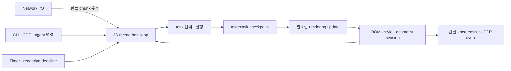

# OxiBrowser 헤드리스 브라우저 호환성 연구

작성일: 2026-10-25 (KST)  
검토 기준: `4fb4e79bfba136c9432a43658630eea6f40189f5`, OxiBrowser 0.27.0, Boa 0.22.0, Blitz 0.3.0-beta.1  
출발 문서: [SPA 렌더링 인계](../HANDOFF_SPA_RENDERING.md)  
실험 원본: [fixtures·JS 명령·응답·바이너리 해시·패키지 출처](2026-10-25-headless-evidence.json)

## 1. 결론과 권고

**현재 Rust 엔진을 유지하면서 일반적인 SPA의 읽기·클릭·입력·이동을 지원하는 방향은 타당하다. 다만 누락 API 몇 개를 추가하는 작업보다, 브라우저 실행 모델을 일관되게 연결하는 작업이 먼저다.** 이번 조사에서 확인한 가장 큰 장애물은 다음과 같다.

1. 같은 DOM 노드가 조회할 때마다 다른 JavaScript 객체가 된다. 프레임워크가 노드에 저장한 상태가 다음 조회에서 사라진다.
2. `window`, `self`, `globalThis`의 관계와 API 노출이 일관되지 않다. 전역 `getComputedStyle`이 있어도 `window.getComputedStyle`은 없는 상태가 재현됐다.
3. 이벤트 루프가 명령 처리와 임시 큐 배출 중심이다. 일부 미완료 비동기 continuation을 버리고, 타이머 예외를 무시하며, `--await`가 아직 끝나지 않은 Promise를 `null`로 반환하는 경우가 있다.
4. script의 종류·삽입 경로·실행 순서·로딩 완료 이벤트가 하나의 모델로 연결되어 있지 않다. ESM도 classic script처럼 평가된다.
5. 실제 렌더링과 JavaScript의 스타일 조회가 다른 계산을 사용한다. Fetch 응답은 문자열로 전달되어 바이너리까지 손상된다.

따라서 **측정 기준 → DOM/Window 및 이벤트 루프 → script/module 로더 → CSSOM/레이아웃 → 바이너리 Fetch/Streams → 프레임워크·CDP 검증** 순서의 개발을 권고한다. 바이너리 보존처럼 범위가 작은 결함은 앞 단계에서 함께 수정할 수 있다. Canvas는 이 기반 위에서 별도 범위로 진행한다.

이는 구현 승인이 끝난 설계가 아니라, 코드와 재현 실험에 근거한 제안이다. 이번 작업은 연구 문서와 증거를 만들었으며 엔진 코드를 변경하지 않았다. “19/21 텍스트 출력”과 “현대 웹 앱을 조작할 수 있는 브라우저”는 서로 다른 완료 조건이다.

## 2. 무엇을 확인했는가

| 구분 | 범위와 한계 |
|---|---|
| 코드 | JS runtime/job queue, DOM snapshot, render document, network bridge, CDP Runtime, corpus 판정 코드 |
| 빌드 | 현재 checkout에서 `cargo build -p oxibrowser --locked` 성공 |
| 기존 테스트 | `test_get_computed_style` 필터의 core 단위 테스트 6개 통과. 전체 workspace 테스트는 재실행하지 않음 |
| 통제 실험 | 로컬 HTTP 서버, 새 CLI session, 외부 인증·쿠키 없이 DOM/API/module/binary 응답 검사 |
| 프레임워크 | npm 배포본 React/ReactDOM **18.2.0 development UMD**로 최소 counter 앱 실행. 버전·asset SHA-256 보존 |
| 실사이트 | Daum, Spotify, MDN 각 1회. 네트워크·배포·지역에 따라 결과가 달라질 수 있음 |
| 외부 근거 | WHATWG/W3C 표준, 버전을 고정한 Boa 문서, React 소스, Blitz·Servo·Playwright 공식 자료 |
| 미확인 | 전체 WPT, Chrome과의 차등 실행, React 19/Vue/Svelte/Next.js fixtures, Canvas/WebGL 대상 사이트의 실제 API 사용, 성능 비교 |

이하 **확인**은 코드 또는 이번 실행에서 확인한 사실, **추론**은 그 영향에 대한 해석, **제안**은 앞으로 구현·검증할 내용이다. 외부 API 문서의 “모듈이 존재한다”는 설명도 실제 구현 상태와 구분했다.

### 기존 17/21의 의미

[corpus runner](../../crates/oxibrowser/tests/compat_corpus.rs)는 프로세스가 성공 종료하고 stdout 길이가 0보다 크면 `PASS`로 분류한다. JS 예외 개수는 기록하지만 통과를 막지 않는다. 화면, hydration, 클릭, 라우팅은 검사하지 않는다.

[기존 결과](../quality/compat-report.md)의 MDN·GitHub·BBC는 텍스트 출력에는 성공했고 각각 JS 오류가 있었다. Figma 홈페이지의 텍스트가 나온다는 사실도 Figma 편집기가 실행된다는 증거는 아니다. 이 17/21은 과거 측정치를 인용한 것이며, 이번에 21개 전체를 다시 측정한 결과가 아니다.

## 3. 인계 문서에서 수정해야 할 전제

| 인계 설명 | 재검증 결과 | 계획에 미치는 영향 |
|---|---|---|
| `getComputedStyle` 미구현 | 전역 함수는 존재. 간이 snapshot 스타일 계산을 사용하며 실제 session의 `window`에서는 함수가 사라짐 | 함수 추가보다 Window 연결, 실제 CSS 결과 조회, 객체 생명주기 수정이 필요 |
| `EventTarget` 생성자 부재 | 생성자는 있으나 `new EventTarget()`에 listener/dispatch 메서드가 없음 | 존재 여부가 아닌 동작·상속·이벤트 전달 검사로 전환 |
| React 18 `root.render`가 `new EventTarget()`을 요구 | 검사한 18.2.0 root 소스와 배포본에서 이 주장을 뒷받침하지 못함 | 특정 사이트 실패 원인으로 단정하지 않음. EventTarget 자체의 결함은 별도로 수정 |
| MessageChannel 부재 때문에 React scheduler가 시작하지 못함 | React 18.2 scheduler에는 `setTimeout` fallback이 있음 | 타이머와 task 실행이 올바른지도 함께 검증 |
| MessageChannel을 `queueMicrotask`로 대체 | message 전달은 task source를 사용 | yield를 없애는 microtask 대체 구현을 채택하지 않음 |
| RO/IO를 microtask로 호출하면 표준에 맞음 | 비동기라는 공통점만으로 동일하지 않음. ResizeObserver는 rendering update와 연결되고 IO는 별도 task로 통지 | 실제 레이아웃과 표준의 delivery 단계에 연결 |
| SRI에 `SubtleCrypto.verify` 필요 | SRI는 리소스 바이트의 암호학적 digest와 metadata 비교 | native loader에서 검증 가능. JS `crypto.subtle` 구현과 독립시킴 |
| `renderToPipeableStream` 때문에 브라우저 Web Streams 필요 | 해당 React API는 Node 서버용 | 브라우저의 Fetch body/클라이언트 스트리밍과 서버 렌더링 API를 구분 |
| 색·폰트까지 Taffy에서 computed style 조회 | Stylo가 CSS cascade/computed values, Taffy가 박스 layout 담당 | 스타일은 Stylo, used geometry는 layout에서 가져오는 adapter 설계 |
| classic script의 CORS를 무조건 우회 | classic/module/`crossorigin`에 따라 fetching 규칙이 다름 | fetch 목적별 mode·credentials·CSP·SRI를 유지하는 loader로 교체 |
| ICU 지원에는 아키텍처 변경 필수 | Boa 0.22에는 `intl`/`intl_bundled` feature가 있고 현재 의존성 feature에는 활성화되어 있지 않음 | feature/data/용량 실험부터 진행. 모든 locale 지원이 자동 확보된다는 뜻은 아님 |
| Phase 1은 시간 단위 API 추가로 완료 | 메서드 이름을 제공하는 시간과 브라우저 동작을 검증하는 시간이 혼재 | 완료 기준을 fixture와 표준 의미로 다시 정의 |

근거: [React root 구현](https://github.com/facebook/react/blob/v18.2.0/packages/react-dom/src/client/ReactDOMRoot.js), [React scheduler fallback](https://github.com/facebook/react/blob/v18.2.0/packages/scheduler/src/forks/Scheduler.js), [MessagePort task](https://html.spec.whatwg.org/multipage/web-messaging.html#message-ports), [ResizeObserver](https://drafts.csswg.org/resize-observer/), [IntersectionObserver task](https://w3c.github.io/IntersectionObserver/#queue-intersection-observer-task), [SRI](https://www.w3.org/TR/sri/), [React 서버 API](https://react.dev/reference/react-dom/server/renderToPipeableStream), [Boa features](https://docs.rs/boa_engine/0.22.0/boa_engine/#crate-features).

## 4. 재현된 결함과 중요도

### 4.1 로컬 실험

CSS fixture는 `#box { color:rgb(12,34,56); width:123px; height:45px }`, 화면 밖 요소는 `top:5000px`이다. 각 응답과 실행 순서는 [증거 JSON](2026-10-25-headless-evidence.json)에 있다.

| 실험 | 기대 | 이번 결과 | 우선순위 |
|---|---|---|---|
| `window === globalThis`, `window === self` | window realm에서 동일한 전역 접근 | 둘 다 `false` | P0 |
| 전역/Window `getComputedStyle` | 같은 API에 접근 | 전역 `function`, Window `undefined` | P0 |
| 같은 ID 두 번 조회 | 같은 노드 wrapper | `=== false` | P0 |
| 노드에 `__probe=42` 저장 후 재조회 | 42 유지 | 속성이 없어 `null`로 정규화됨 | P0 |
| 조회한 요소의 `instanceof Node/Element/HTMLElement` | 모두 true | 모두 false | P0 |
| `new EventTarget()` | listener/dispatch 메서드 제공 | 둘 다 undefined | P0 |
| `insertBefore(B, null)`; 기존 자식 I | I, B | B, I | P0 |
| stylesheet 기반 computed style | 지정 색, `123px` | `#000000`, `auto` | P0 |
| `setAttribute('style', 'font-size:23px;…')` 후 조회 | `23px` | 같은 eval과 다음 eval 모두 `16px` | P0 |
| `getPropertyValue('font-size')`/`opacity` | CSS 문자열 | 빈 문자열 | P0 |
| 50ms timer Promise를 session `eval --await` | `done` | 성공 응답의 `value:null` | P0 |
| `type=module`의 `export const value=42` | module 평가 완료 | `unexpected token 'export'`; 결과 변수 undefined | P0 |
| script append/insert + load callback | 코드 실행, load 통지 | 후속 pump 뒤에도 실행 0회, load false, helper undefined | P0 |
| 원본 `[0,128,255,65]`의 `arrayBuffer()` | ArrayBuffer, 원본 4바이트 | Uint8Array, `[0,239,191,189,239,191,189,65]` | P0 |
| ResizeObserver 초기 크기 | 123 CSS px | 1 | P1 |
| viewport 밖 IntersectionObserver | 비가시 상태 | `isIntersecting:true` | P1 |

DOM 동일성은 사소한 표면 차이가 아니다. React 18은 DOM 노드에 내부 fiber/props 값을 저장하고 다시 조회한다. wrapper가 바뀌면 이 연결이 끊어질 수 있다. 다만 **이것이 이번 React fixture 실패의 유일한 원인이라는 인과 실험까지 수행한 것은 아니다.** [React DOM 노드 상태 구현](https://github.com/facebook/react/blob/v18.2.0/packages/react-dom/src/client/ReactDOMComponentTree.js).

추가로 DOMException, MessageChannel, 세 종류 Streams, Worker, FileReader, CSSStyleSheet, CanvasRenderingContext2D, Range/TreeWalker/NodeIterator, Selection, `crypto.subtle`의 부재를 관찰했다. 모든 인터페이스·메서드를 조사한 전체 지원표는 아니다.

### 4.2 최소 React 앱

React/ReactDOM 18.2.0을 로컬 서버에서 불러오고 `createRoot(...).render(...)`로 stateful button을 만들었다. 두 라이브러리는 전역 객체로 로드됐고 초기 `try/catch`의 `bootError`는 null이었다. 그러나 root는 비어 있었고, `#counter` 대기 명령은 timeout, 클릭은 `DOM_NOT_FOUND`로 끝났다.

이 fixture는 외부 CDN·로그인·광고·봇 방어를 제외한 회귀 기준으로 쓸 수 있다. 현재 결과는 정상 동작 확인이 아닌 **실패 baseline**이다. 다음 단계에서는 타이머 callback 예외와 scheduler task trace를 수집해 최초 실패를 최소화해야 한다. 증거에는 fixture HTML과 배포 파일의 SHA-256을 보존했다.

### 4.3 실사이트 표본 재검증

| 대상 | 이번 관찰 | 해석 |
|---|---|---|
| Daum | 200, title `Daum`, text 빈 문자열; uninitialized binding·recursion limit 등 오류 | 빈 결과 재현. 특정 API 하나로 원인을 확정할 수 없음 |
| Spotify | `open.spotify.com`으로 이동, 200, text 빈 문자열, `not a constructor` | 기존 실패 재현. 오류 난 생성자의 실체는 추가 축소 실험 필요 |
| MDN Web/API | text 총 28,384 bytes, `export` 구문 오류 5건 | SSR 추출 성공과 module 실행 실패가 동시에 존재 |

각 사이트 1회 표본이며 hydration·클릭·스크린샷 검증은 하지 않았다. JSON 출력은 300바이트로 제한했으므로 MDN 전체 길이는 `total_bytes`를 사용했다. `--timeout 15`에도 전체 실행 시간이 Daum 약 28.4초, Spotify 약 16.8초였으므로 이 옵션을 전체 작업의 wall-clock deadline으로 간주하지 않았다. 측정 프로세스에는 별도로 45초 제한을 두었다.

## 5. 가장 먼저 고칠 구조

### 5.1 DOM·Window 객체와 수명을 일원화한다

현재 [runtime.rs](../../crates/oxibrowser-core/src/js/runtime.rs)의 `create_render_element_object`/`create_element_object`와 여러 bootstrap이 객체를 독립적으로 만든다. `register_window_globals`는 별도 Window 객체를 만들며, history bootstrap은 `Object.assign`으로 다시 복제한다. 실제 노드와 JS wrapper 사이의 동일성, prototype, expando 유지가 핵심 불변식이어야 한다.

제안:

- `(realm_id, document_generation, node_id)`를 기준으로 node wrapper를 관리한다. 조회·event target·parent/children·CDP node 반환이 같은 wrapper를 사용하도록 한다.
- 모든 DOM 객체에 실제 prototype chain과 brand check를 제공한다. 빈 생성자만 추가해 `instanceof`와 feature detection을 통과시키는 방식은 중단한다.
- node id 재사용과 navigation을 구분한다. 이전 문서의 wrapper를 새 문서의 노드로 잘못 연결하지 않는다.
- 초기에는 document 수명 동안 wrapper를 root하는 단순한 방식도 가능하지만, detached subtree와 listener를 계속 붙잡는 메모리 비용을 측정하고 GC tracing/weak cache 설계를 보완한다.
- Window의 전역 접근을 Boa realm/global 설정과 연결한다. 단순히 한 줄로 alias를 바꾸기 전에 WindowProxy·navigation·iframe·telemetry proxy의 관계를 정리한다.
- renderer는 JS thread 안에 두고 snapshot은 버전이 있는 관찰용 결과로 취급한다. JS가 수정한 DOM, 스타일 조회, 스크린샷, agent observation이 같은 문서 revision을 가리키게 한다.

첫 완료 조건은 wrapper 동일성, expando, prototype, `insertBefore(null)`, remove/reinsert, fragment 삽입, navigation 후 stale handle fixture 통과다. 이후 listener capture/bubble/once/passive/AbortSignal, `preventDefault`, form/input 기본 동작을 연결한다. 규범 기준은 [DOM Standard](https://dom.spec.whatwg.org/)다.

### 5.2 이벤트 루프를 명령 대기와 분리한다

확인한 현재 경로:

- `js_thread_loop`는 `cmd_rx.recv()`로 명령을 기다린다. idle 상태에도 timer/network/rendering 작업을 지속 처리하는 범용 루프가 아니다.
- [job_queue.rs](../../crates/oxibrowser-core/src/js/job_queue.rs)의 `drain_jobs`는 지역 `FuturesUnordered`, noop waker, 1,000회 제한을 사용하며 남은 async continuation을 버린다.
- `drain_timers`는 callback의 오류 반환을 무시한다. 여러 곳의 `let _ = ctx.run_jobs()`도 오류 관측을 약화시킨다.
- `await_promise_value`는 반복 횟수 중심으로 기다린다. 이번 timer Promise 실험에서 결과가 준비되기 전에 null이 반환됐다.

제안은 **JS thread가 context와 render document를 소유하면서 지속적으로 task를 처리하는 host loop**다. 단순히 iteration cap을 높이거나 모든 queue를 무한히 drain하는 변경은 해결이 아니다.



이 그림은 소유권과 데이터 흐름이다. rAF·ResizeObserver·IO의 정확한 순서를 임의로 고정한 의사 표준이 아니다. [HTML event loop](https://html.spec.whatwg.org/multipage/webappapis.html#event-loops)의 task/microtask/rendering 구분을 구현 기준으로 삼는다.

- task source를 timer, network completion, message port, DOM event 등으로 구분하고 각 source의 순서를 보존한다. source 사이 순서까지 하나의 전역 FIFO로 가정하지 않는다.
- pending async 상태와 wakeup은 다음 turn까지 보존한다. Boa의 context borrow를 넘겨야 하는 future를 그대로 self-referential 구조에 넣기 전에 0.22 API로 작은 실행기 실험을 한다. 전용 thread 안의 local executor나 host 작업 상태 기계가 후보이며 기존 fetch channel을 활용할 수 있다.
- MessagePort는 task로 전달하고, rAF는 rendering 기회에 연결한다. task 뒤 Promise/mutation observer 처리는 해당 checkpoint에서 수행한다.
- timer/Promise/observer 예외와 unhandled rejection을 source URL·phase·context와 함께 관측한다. 복구 가능한 페이지 오류가 다른 task queue를 지우지 않게 한다.
- wall-clock·instruction·memory 한도를 구분한다. budget 초과를 `incomplete`/timeout으로 명시하고, 성공처럼 continuation을 버리지 않는다.
- 자동화의 `waitFor(selector)`와 `awaitPromise`는 같은 루프가 상태를 진행시키도록 한다. “network가 조용함”을 앱 완료의 유일한 기준으로 삼지 않는다.

첫 완료 조건: `task → promise microtask → 다음 task` 순서, 지연 timer Promise, message ping-pong, 지연 fetch, idle 중 timer, cancellation, 무한 microtask/interval의 명시적 budget 종료다.

### 5.3 script/module을 native ResourceLoader로 통합한다

[ScriptSource](../../crates/oxibrowser-core/src/js/dom_snapshot.rs)는 kind/timing을 기록하지만 navigation 실행은 `ctx.eval`을 사용한다. `nomodule`은 module 지원을 전제로 건너뛰므로, module 평가 실패 시 fallback까지 실행되지 않을 수 있다. 동적 script helper는 JS `fetch + eval`이며 이번 session에서는 helper 자체가 없었다.

제안하는 loader 상태는 `discovered → fetching → ready → executing → complete/error`다. 상태에는 document generation, element identity, 최종 URL, classic/module, parser-inserted 여부, async/defer, credentials, integrity, cancellation을 포함한다.

| 단계 | 구현 내용 | 완료 조건 |
|---|---|---|
| classic 기반 | appendChild/insertBefore/연결 후 src 변경을 공통 DOM 연결 경로에서 감지; exactly-once 평가; `currentScript`, load/error | 같은 script를 옮겨도 중복 실행하지 않음; 성공·404·취소의 이벤트 검증 |
| 요청 정책 | script 목적의 fetch mode/credentials/referrer/MIME/CSP/SRI를 처리 | 교차 origin classic/module, `crossorigin`, 잘못된 SRI를 두 origin fixture로 검증 |
| ESM | Boa Module parse/link/evaluate와 URL 기반 module map, 정적 import·동적 import·`import.meta.url`·top-level await | 중복 import가 중복 평가되지 않음; cycle/error/TLA/상대 URL 통과 |
| 문서 실행 순서 | parser-blocking classic, defer, async, module과 DOMContentLoaded/load 관계 | 순서 fixture와 lifecycle trace 일치 |
| 이후 | import map, modulepreload, 추가 module type; incremental parsing과 `document.write` 범위 | 지원 범위를 capability에 표시하고 관련 WPT 통과 |

Boa 0.22는 [ModuleLoader host hook](https://docs.rs/boa_engine/0.22.0/boa_engine/module/trait.ModuleLoader.html)을 제공한다. ESM 문법 엔진을 새로 만드는 대신 브라우저의 URL·origin·fetch 규칙을 이 hook에 연결한다. TLA와 비동기 module loading은 앞 절의 continuation 보존을 필요로 한다.

classic cross-origin script와 `fetch()`는 같은 접근 규칙이 아니다. **CORS 검사 전부를 끄는 변경은 제안하지 않는다.** 기존 SSRF, account cookie jar, origin 정책, redaction, network interception 경로를 ResourceLoader에서도 공유한다. SRI는 검증 전 원본 바이트를 보존해야 한다. [HTML script 처리](https://html.spec.whatwg.org/multipage/scripting.html#the-script-element), [Fetch](https://fetch.spec.whatwg.org/), [SRI](https://www.w3.org/TR/sri/).

## 6. 실제 렌더링 상태를 Web API와 연결한다

### 6.1 스타일과 기하 정보

현재 `getComputedStyle`은 [간이 LayoutEngine](../../crates/oxibrowser-core/src/css/layout.rs)을 호출한다. 이 코드는 스스로 flex/grid/media query를 무시한다고 설명한다. 반면 [RenderDocument](../../crates/oxibrowser-render/src/document.rs)는 Stylo/Taffy를 통해 실제 레이아웃을 만든다. `getPropertyValue`도 camelCase 키와 문자열만 조회하여 kebab-case 이름과 opacity 같은 값에 결함이 있다.

제안:

1. `RenderDocument`에 `ensure_style_current`/`ensure_layout_current`와 CSS 값 직렬화 adapter를 둔다. API 이름은 설계 제안이다.
2. Stylo의 computed values에서 색·폰트·cascade 결과를, 레이아웃에서 필요한 resolved/used geometry를 얻는다. 로컬 Blitz 0.3.0-beta.1의 `Node::primary_styles()`가 접근 출발점이다.
3. 계산된 style 객체를 live/read-only로 제공하고 `getPropertyValue`, camelCase 접근, custom properties, pseudo-element를 단계적으로 지원한다. computed style의 `cssText`를 모든 스타일 직렬화로 잘못 구현하지 않도록 해당 CSSOM 규칙도 검사한다.
4. `styleSheets`, `style.sheet`, `cssRules`, `insertRule/deleteRule`과 동적 style/link 변경을 실제 stylesheet에 반영한다. CSS-in-JS는 값 조회뿐 아니라 rule 삽입도 필요할 수 있다.
5. `getBoundingClientRect`, client/offset/scroll 크기와 좌표계를 한 경로로 맞춘다. transform·ancestor offset·scroll·zoom을 분리하고 element-local layout 좌표를 곧바로 viewport 좌표로 내보내지 않는다.

스타일이 dirty해졌다고 매 JS mutation마다 전체 layout을 수행할 필요는 없다. layout을 요구하는 읽기 또는 rendering update에서 필요한 계산을 수행하고 revision을 갱신한다. 이 정책은 screenshot·hit-test·observer에도 공유한다. [CSSOM](https://drafts.csswg.org/cssom/#dom-window-getcomputedstyle), [Blitz 구성요소 설명](https://github.com/DioxusLabs/blitz/blob/v0.3.0-beta.1/README.md).

### 6.2 Observer와 사용자 입력

ResizeObserver에는 content/border/device-pixel box, 크기 변화, delivery loop 제한이 필요하다. IntersectionObserver에는 root/rootMargin/threshold, viewport·scroll container clipping, 이동에 따른 교차 변화가 필요하다. 두 API 모두 “observe 직후 1×1 크기로 한 번 호출”을 교체해야 한다. `MutationObserver`의 microtask 전달 방식과 혼동하지 않는다. [ResizeObserver processing model](https://drafts.csswg.org/resize-observer/), [IntersectionObserver processing model](https://w3c.github.io/IntersectionObserver/).

클릭 성공도 native mutation만으로 정의하지 않는다. 대상 선정, 실제 geometry, hit-test, focus, pointer/mouse event, default action, 프레임워크 state 변경이 이어지는지 확인한다. 입력에는 selection, composition/IME, input/change, validation을 별도 검증한다. Range·Selection은 텍스트 편집기 진입 단계에서 필요하며, 빈 객체로 채우는 대신 최소 동작 범위를 명시한다.

## 7. Fetch·Streams·추가 Web API를 구현하는 방식

### 7.1 바이트 보존부터 수정한다

`FetchResponseMsg.body`가 `String`이고 `settle_fetch`의 `arrayBuffer`가 그 문자열의 UTF-8 바이트로 Uint8Array를 만든다. 4바이트 fixture의 손상은 이 설계와 일치한다. Wasm·이미지·파일·SRI의 기반 문제이므로 Streams 생성자보다 먼저 또는 함께 수정한다.

제안하는 body 경로:

```text
HTTP bytes → bounded byte chunks → JS ReadableStream<Uint8Array>
                                    ├─ arrayBuffer(): ArrayBuffer
                                    ├─ text(): decode once
                                    ├─ json(): text + parse
                                    └─ blob()/formData(): 타입별 소비
```

초기 단계는 원본 `Vec<u8>` 보존만으로도 가치가 있다. 다음 단계에서 header 수신 시 Response를 제공하고 body가 순차 유입되게 한다. locked/disturbed/bodyUsed, single consumption, clone/tee, cancellation, AbortSignal, error propagation을 함께 검증한다. 제한 없는 chunk 버퍼와 backpressure 없는 구현은 큰 응답에서 메모리 문제를 만든다. [Fetch Body](https://fetch.spec.whatwg.org/#body-mixin), [Streams](https://streams.spec.whatwg.org/).

### 7.2 직접 구현과 재사용을 나눈다

| 후보 | 활용 판단 | 반드시 확인할 것 |
|---|---|---|
| `boa_runtime 0.22` | API별 구현을 검토해 선택적으로 재사용 | 현재 network/account bridge, timer executor, error type과 연결 가능한가 |
| `boa_wintertc 0.22` | 전체 등록으로 브라우저 API가 완성된다고 가정하지 않음 | events는 구현 TODO, fetch는 runtime에서의 migration TODO가 명시됨 |
| `web-streams-polyfill` | 검증된 JS Streams 구현 후보 | Boa에서 동작, 크기·성능, byte stream/BYOB 범위, native fetch body와 동일한 타입 체계 |
| Boa `intl`/`intl_bundled` | 수작업 Intl 흉내를 줄일 첫 실험 | 지원 locale/API, ICU 데이터 배포, binary/startup/RSS 증가 |
| Rust crypto 라이브러리 | `digest` 등 실제 알고리즘 구현에 재사용 | BufferSource, Promise, algorithm normalization, secure context, 오류명 |
| 기존 wasmi·IDB·WebSocket 경로 | 이미 있는 기능을 regression 대상으로 포함 | binary body, structured clone, storage 수명, event ordering과의 통합 |

[WinterTC events 0.22](https://docs.rs/boa_wintertc/0.22.0/boa_wintertc/events/index.html), [WinterTC fetch 0.22](https://docs.rs/boa_wintertc/0.22.0/boa_wintertc/fetch/index.html), [boa_runtime](https://docs.rs/boa_runtime/0.22.0/boa_runtime/), [Streams polyfill의 Fetch 통합 주의점](https://github.com/MattiasBuelens/web-streams-polyfill#usage), [Boa Intl feature](https://docs.rs/boa_engine/0.22.0/boa_engine/#crate-features).

단일 시스템을 유지하려면 이미 등록한 전역을 다른 패키지가 조용히 덮어쓰지 않게 해야 한다. polyfill도 버전·라이선스·fixture 결과를 고정하고, 초기화 순서와 navigation 후 재등록을 테스트한다. “존재하면 사용”하는 웹의 feature detection 때문에 부정확한 stub은 아예 미지원인 경우보다 나쁜 경로를 선택시킬 수 있다.

### 7.3 나머지 API 우선순위

- **P1:** DOMException, 제대로 된 EventTarget 계층, AbortSignal, TextEncoder/Decoder, 핵심 URL/Headers/Request/Response. DOM/event/resource 기반과 함께 구현한다.
- **P1~P2:** TreeWalker/NodeIterator, Range의 선택된 연산, FileReader·Blob·FormData. editor/upload fixture에서 요구되는 범위를 정한다.
- **P2:** dedicated Worker. iframe context와 달리 독립 실행·event loop·termination이 필요하다. Boa 객체를 thread 간 공유하지 않고 structured clone된 메시지를 전달한다.
- **P2:** SSE/EventSource, BroadcastChannel, 실제 navigation/history 및 iframe messaging 확장. 장기 연결을 readiness 판정에서 별도로 처리한다.
- **P3:** Service Worker, Cache Storage, SharedWorker, SharedArrayBuffer/Atomics. origin·lifetime·interception·격리 요구가 크므로 별도 milestone으로 둔다.
- **후순위:** PerformanceObserver는 실제 entry가 있는 타입부터, Notification은 headless에서 허용되는 기능과 permission 결과부터 제공한다. 단순히 성공하는 stub을 넣지 않는다.

## 8. Canvas·WebGL·미디어의 범위를 분리한다

Canvas 2D는 `tiny-skia`나 기존 Vello CPU 같은 rasterizer를 재사용할 수 있는 영역이다. 그러나 rasterizer가 있어도 브라우저 Canvas API가 저절로 생기지는 않는다.

첫 Canvas milestone은 rect/path/transform/save-restore/clip/drawImage/text 측정·그리기/pixel readback과 HTMLCanvasElement의 크기 변경·초기화다. bitmap을 renderer의 `<canvas>` 노드와 연결하고 screenshot 합성까지 확인해야 한다. cross-origin 이미지의 origin-clean 상태, `getImageData`/`toDataURL` 제한도 같은 모델에 들어간다. Parley font 사용과 baseline/text metrics를 검토할 수 있다.

“fillRect와 drawImage로 대부분 해결”이라는 비율은 이번 조사에서 입증되지 않았다. Chart.js 등 특정 버전의 fixture와 pixel/reference 테스트로 범위를 정한다. `dice6.win`이 Canvas 2D만으로 충분한지도 이번에 측정하지 않았다.

WebGL/WebGPU는 GPU backend만 연결하는 작업이 아니다. API binding, resource lifetime, shader, synchronization, readback, context loss, 브라우저 보안 의미까지 필요하다. 후속 [WebGL 오픈소스 조사](2026-10-25-webgl-open-source.md)는 ANGLE의 WebGL 검증 모드, Servo·Ladybird의 구현, 기존 CPU renderer로의 canvas 합성 경로를 비교한다. offscreen WebGL 연구가 페이지 전체 GPU compositor 도입을 전제로 하지는 않는다.

현재 소스에는 Canvas/WebGL shim도 존재한다. 위 글로벌 인터페이스 부재 관찰은 shim 자체가 없다는 뜻이 아니다. `CANVAS_BOOTSTRAP`의 WebGL 그리기·셰이더 메서드는 no-op이며, 실제 픽셀 출력과 연결되지 않는다. 후속 조사에 소스 근거와 교체 경계를 기록했다.

영상/음성도 페이지 탐색과 실제 decode/playback, DRM/EME를 구분한다. YouTube 페이지의 텍스트 추출과 재생 성공을 한 지표로 합치지 않는다.

## 9. CDP 호환성과 차단 사이트를 별도로 검증한다

### CDP

현재 [Runtime handler](../../crates/oxibrowser-cdp/src/domains/runtime.rs)는 일반 remote object에 대한 `returnByValue=false`에서도 inline value를 반환하고, 실제 `objectId` 구현 TODO가 있다. `callFunctionOn`은 특정 `oxi-node-` 참조를 별도로 다룬다. 이것은 Puppeteer/Playwright의 전체 객체 handle 모델과 같지 않다.

따라서 “CDP endpoint에 연결된다” 다음에 아래 경로를 별도로 검증해야 한다.

1. version을 고정한 Puppeteer/Playwright가 attach하고 target/context를 찾는다.
2. evaluate/evaluateHandle, getProperties, callFunctionOn, releaseObject가 수명과 exception을 보존한다.
3. locator가 visibility·stability·enabled 상태를 검사하고 click/fill 후 앱 상태를 확인한다.
4. navigation/iframe/new target, lifecycle event, network event와 body, screenshot이 일관된다.
5. unsupported command는 명확한 protocol error를 반환한다. 성공 응답만 제공해 클라이언트를 잘못 진행시키지 않는다.

초기에는 Oxi native agent path와 명시한 CDP subset을 제품 범위로 제시하고, 지원 client/version/시나리오 표를 유지한다. Playwright도 CDP 연결이 자사 protocol보다 제한적이라고 명시한다. [Playwright connectOverCDP](https://playwright.dev/docs/api/class-browsertype#browser-type-connect-over-cdp).

### Bot wall

403·challenge·로그인 필요·지역 제한은 렌더링 실패와 분류를 분리한다. TLS fingerprint 업데이트만으로 해결된다는 보장은 없다. Cloudflare는 production challenge에서 자동화 브라우저를 지원하지 않는다고 설명한다. 정상 Chrome도 서비스 정책과 환경에 따라 차단될 수 있다. [Cloudflare 지원 환경](https://developers.cloudflare.com/cloudflare-challenges/reference/supported-browsers/).

제품의 완료 조건은 모든 challenge 우회가 아니라, 차단 원인을 보고하고 허용된 API 또는 기존 account/import·사용자 개입 경로로 연결하는 것이다. 이 작업은 anti-detect 기법이나 proxy 구매를 구현 우선순위에 넣지 않는다. 외부 브라우저 위임을 제품에 넣는 것은 현재 단일 Rust 엔진 정책과 별도의 결정이다.

## 10. 가능한 전략 비교

| 전략 | 장점 | 비용·제약 | 판단 |
|---|---|---|---|
| 사이트별 stub·예외 추가 | 특정 오류를 빠르게 관찰·완화 | 잘못된 feature detection, 상태 불일치, 사이트 변경에 취약 | 원인 축소용 임시 실험으로 제한 |
| **Boa + Blitz 기반 host/browser layer 정비** | Rust JS 엔진·기존 5 crates·agent 경로 유지 | DOM binding, event loop, loading의 통합 비용 | **권고** |
| Servo 전체 엔진 채택 | 브라우저 DOM/event/loading 구현을 넓게 활용 가능 | SpiderMonkey 결합, footprint·배포·CDP 재통합; 현재 C/C++ JS 엔진 비목표와 충돌 | 현 정책에서는 대체안으로 채택하지 않음 |
| 외부 Chromium/WebKit/Firefox 실행 위임 | 폭넓은 호환성 확보를 별도 backend로 접근 | 설치·메모리·운영 비용, 현재 제품 정체성과 범위 변경 | 사용자가 범위를 변경할 때 검토할 선택지 |

Blitz는 HTML/CSS 구성요소 엔진으로 전체 브라우저 기능 제공을 목표로 하지 않는다. 반대로 Servo의 JS 엔진 교체도 단순한 adapter 변경으로 볼 수 없다. 따라서 Blitz/Boa의 업데이트를 기다리는 것만으로 OxiBrowser의 browser host layer가 완성되지는 않는다. [Blitz 목표](https://github.com/DioxusLabs/blitz/blob/v0.3.0-beta.1/README.md), [Servo와 SpiderMonkey 결합 분석](https://servo.org/blog/2024/04/15/spidermonkey/).

## 11. 달성 여부를 측정하는 체계

### 세 종류의 테스트를 유지한다

| 층 | 질문 | 실행·판정 |
|---|---|---|
| 표준 동작 | API가 의미상 맞는가? | 고정 WPT revision의 선택된 `dom`, event loop, `html/semantics/scripting-1`, `css/cssom`, `fetch`, `streams`, observers 테스트 |
| framework fixtures | 번들·hydration·event·router가 연결되는가? | 버전 고정 React 18/19, Vue, Svelte, Next 계열; mount → interaction → state/route assertion |
| 실제 서비스 | 제품이 목표 작업을 수행하는가? | 고정 task corpus, 필요 시 로그인 상태를 명시; challenge는 별도 결과 |

WPT는 `testharness.js`의 명시적 결과와 subtest 결과를 수집한다. runner가 지원하지 않는 `.any.js`, worker, testdriver, HTTPS/multi-origin 요구는 skip 이유를 기록한다. 선택한 subset의 통과율을 전체 WPT 통과율처럼 표시하지 않는다. `idlharness`는 prototype/IDL 점검에 유용하지만 실제 동작 테스트를 대체하지 않는다. [WPT testharness 문서](https://web-platform-tests.org/writing-tests/testharness.html).

### corpus PASS를 작업 성공으로 바꾼다

각 fixture/site에 다음을 명시한다.

- 기대 콘텐츠 marker와 최소한의 핵심 DOM 구조. byte count는 보조 지표로 유지한다.
- UI 노출이 필요한 경우 visible geometry와 screenshot 또는 reference image.
- 상호작용의 전후 상태. 예: 버튼 label 0→1, 입력→submit→결과 marker, 링크→route 변경.
- 부트스트랩 단계의 치명적 예외, 실패한 필수 리소스, 기다리는 task의 상태.
- `CONTENT_OK`, `INTERACTION_OK`, `BLOCKED`, `UNSUPPORTED`, `BUDGET_EXCEEDED`, `CRASH` 등 의미가 구분되는 결과.

M0에서 기존 corpus와 새 기준을 함께 실행해 baseline을 만든다. 이번 연구만으로 “새 기준 80%” 같은 수치는 제시할 수 없다. 완료 판정은 사전에 고정한 fixture 전체 통과, 선택 WPT의 regression 없음, 측정 대상 사이트의 지정 작업 성공으로 삼는다.

### 성능·안정성도 같은 결과에 묶는다

release build와 동일 machine/viewport/font/network fixture에서 cold start, peak RSS, first useful content, interaction latency, CPU time, binary size를 측정한다. 처리 못 한 앱의 빠른 종료를 성능 우위로 계산하지 않는다. pass한 동일 작업끼리 비교한다.

크래시·hang은 외부 subprocess deadline으로 격리하고 source URL/hash, load phase, pending tasks, layout revision을 남긴다. 예외 stack만으로 이름 없는 minified constructor를 추측하는 것보다, **실패 번들 → 최소 fixture → 수정 → regression fixture**의 반복이 효율적이다. 광고 script 오류와 본문 앱의 필수 오류도 구분한다.

## 12. 실행 로드맵과 완료 조건

아래 기간은 Rust/JS embedding 경험자가 해당 범위를 전담한다는 가정의 **공학적 추정**이다. 실제 구현으로 검증된 일정이 아니며, 브라우저 전체 표준 구현 비용을 포함하지 않는다. 첫 2주의 결과로 재산정한다. 목표 사이트 수나 기존 byte corpus 비율로 완료를 약속하지 않는다.

| 단계 | 작업 | 선행 조건 | 완료 조건 | 대략적인 노력 |
|---|---|---|---|---|
| M0 | 증거·실패 분류·local framework/WPT subset harness | 없음 | 기존 corpus와 새 task 기준 baseline, timer/Promise 오류 관측 | 3–5 인일 |
| M1 | DOM wrapper/Window/prototype·핵심 mutation·host loop | M0 | 동일성/expando/순서/await/idle timer 통과; React 최초 실패가 재현 trace로 설명됨 | 2–4 인주 |
| M2 | native classic loader·ESM·lifecycle | M1 | dynamic chunk와 load/error, import graph/TLA, 실행 순서 fixture 통과 | 2–4 인주 |
| M3 | Stylo CSSOM·geometry·RO/IO | M1, style resource 경로는 M2 | CSS-in-JS·responsive·virtual list fixture의 실제 상태 검증 | 2–4 인주 |
| M4 | 바이트 Fetch·Streams·필수 Web API | 바이트 수정은 조기 가능, streaming은 M1 | 원본 bytes, reader/cancel/clone, streaming client fixture 통과 | 1–3 인주 |
| M5 | CDP object 수명·client matrix·실사이트 회귀 | M1–M4 | 고정 client/version에서 지정 task 완료, regression 보고서 | 1–3 인주 |
| 후속 | Canvas 2D, Worker, editor 기능 | 관련 기반 단계 | 개별 feature corpus와 자원 한도 통과 | 각각 별도 산정 |

M0–M5의 직렬 합계는 약 **10–19 인주** 수준의 초기 범위다. 기존 코드 수정 난도, Boa/Blitz upstream 결함, parser 통합 범위 때문에 더 늘어날 수 있다. 병행 가능하더라도 리뷰·통합·회귀 비용이 있으므로 투입 인원으로 단순 나누지 않는다. “일반적인 웹 앱을 조작”하는 목표는 수개월 규모로 계획하고, GPU·미디어·Service Worker까지의 범용 브라우저 목표는 별도 장기 프로그램으로 취급한다.

### 첫 2주에 만들 결과물

1. **관측 PR:** timer/Promise/observer 오류를 phase별로 기록하고, 테스트 결과를 byte 출력과 interaction으로 분리한다.
2. **DOM PR:** wrapper identity/expando/prototype/insertBefore 규칙과 navigation generation 테스트를 고친다.
3. **Window PR:** 전역 접근과 bootstrap 재등록을 일원화하고 API가 navigation 중 사라지는 경로를 제거한다.
4. **실행기 실험 PR:** timer Promise·지연 network·idle progress·message task·budget 종료를 증명한다. 결과 없이 기존 executor를 통째로 교체하지 않는다.
5. **작은 data-path PR:** binary body와 ArrayBuffer 반환형을 고치고 4바이트 fixture를 회귀 테스트로 만든다.

이 기간의 판정점은 Spotify가 우연히 한 번 열리는지가 아니다. 위 불변식과 최소 React fixture를 통과시키거나, 남은 최초 실패를 정확한 trace와 축소 입력으로 설명할 수 있어야 한다. 그 결과로 M2–M5 일정과 범위를 조정한다.

### 코드 진입점

| 영역 | 현재 파일·심볼 |
|---|---|
| wrapper·Window | `core/src/js/runtime.rs`: `create_render_element_object`, `create_element_object`, `register_window_globals`, history bootstrap |
| task·Promise | `core/src/js/job_queue.rs`: `TokioJobQueue`, `drain_jobs`; `runtime.rs`: `js_thread_loop`, `await_promise_value`, `settle_to_idle`, `drain_timers` |
| script | `core/src/js/dom_snapshot.rs`: `ScriptSource`, `extract_scripts`; `runtime.rs`: navigation script loop, `__oxi_load_script` |
| fetch bytes | `core/src/js/runtime.rs`: `FetchResponseMsg`, `settle_fetch`; `core/src/session.rs`: fetch bridge; `core/src/network/client.rs` |
| CSS·layout | `core/src/css/layout.rs`; `render/src/document.rs`: `RenderDocument`, `node_layout_rect` |
| automation | `cdp/src/domains/runtime.rs`, `page.rs`, `input.rs`; `core/src/js/runtime/native_action.rs` |
| corpus | `crates/oxibrowser/tests/compat_corpus.rs`, `tests/data/compat_corpus.txt` |

표의 `core`/`render`/`cdp`는 각각 `crates/oxibrowser-core`/`oxibrowser-render`/`oxibrowser-cdp`다. 최초 분리는 새 crate 추가보다 기존 crate 안의 module 경계 정리로 시작한다.

## 13. 재현 방법과 연구 한계

```sh
cargo build -p oxibrowser --locked
cargo test -p oxibrowser-core --lib test_get_computed_style --locked
```

[증거 JSON](2026-10-25-headless-evidence.json)의 `local_probes.fixtures`를 loopback HTTP 서버로 제공하고 `local_probes.commands`의 origin/port를 해당 서버로 바꿔 아래 프로세스에 한 줄씩 전달하면 된다. 바이너리 fixture의 `bytes`는 JSON 문자열이 아닌 실제 바이트 응답이다.

```sh
target/debug/oxibrowser session --allow-private-ips --no-audit
```

React 실험은 `react_18_2.fixture_html`, `assets`의 고정 npm URL·tar member·해시를 사용한다. `react_18_2.commands`에 대기·클릭 검사까지 보존되어 있다. 로컬 실험용 private IP 허용은 production 설정 권고가 아니다.

실사이트 표본 명령:

```sh
target/debug/oxibrowser fetch https://www.daum.net --json --format text --max-bytes 300 --timeout 15 --no-audit
target/debug/oxibrowser fetch https://www.spotify.com --json --format text --max-bytes 300 --timeout 15 --no-audit
target/debug/oxibrowser fetch https://developer.mozilla.org/en-US/docs/Web/API --json --format text --max-bytes 300 --timeout 15 --no-audit
```

외부 프로세스 deadline 45초, 동시성 2로 실행했다. 이 결과는 1회 관찰이며 전체 호환성 점수가 아니다. 현재 단위 테스트 6개가 통과하면서 통합 fixture는 실패한다는 점도 중요한 결과다. 단위 테스트의 snapshot 기반 입력과 실제 document/session 경로를 함께 검사해야 한다.

프로젝트 메모리 조회는 unavailable을 반환하여 이전 결정의 완전한 검색은 확인하지 못했다. 현재 저장소와 이번 실행을 근거로 판단했다. GitHub connector의 React 파일 조회 오류는 공식 raw source 조회로 보완했다. 전체 WPT·Chrome 차등 검사·성능 benchmark·실제 앱 수정은 수행하지 않았다.

조사 도구: `agent-reach`의 Exa 검색, 공식 웹 문서, GitHub read API, 로컬 코드·실행 검사. 도구 업데이트 확인에서는 Agent Reach 1.6.0이 발견됐으며 업데이트는 수행하지 않았다.
