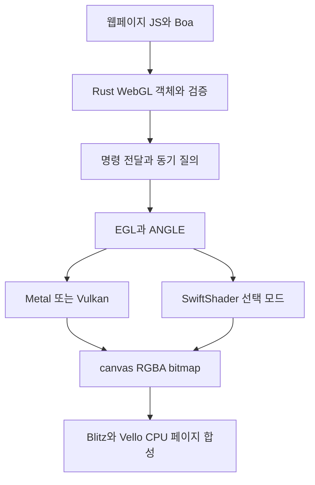

# OxiBrowser WebGL 구현을 위한 오픈소스 조사

작성일: 2026-10-25 KST  
OxiBrowser 기준: `4fb4e79bfba136c9432a43658630eea6f40189f5`  
관련 문서: [브라우저 호환성 연구](2026-10-25-headless-browser-feasibility.md)  
조사 근거: [저장소 revision과 코드 관찰](2026-10-25-webgl-open-source-evidence.json)

## 결론

**가장 현실적인 조합은 Boa용 WebGL 프런트엔드 + ANGLE + Rust GL 바인딩이다. 프런트엔드는 Servo와 Ladybird의 검증·객체 수명·명령 전달 구조를 참고한다.** ANGLE의 WebGL 호환 모드를 이용하면 GLES와 WebGL의 차이를 전부 새로 구현할 필요는 없다. 하지만 JS 객체, canvas, 이미지 출처, 이벤트, 페이지 합성은 OxiBrowser가 연결해야 한다.

이번 조사는 후보 16개 저장소의 현재 기본 브랜치와 관련 소스, Khronos 기준을 확인한 정적 조사다. 후보를 OxiBrowser에 링크하거나 그래픽 테스트를 실행하지 않았다. 지원 표시는 각 프로젝트의 문서·코드 범위이며, OxiBrowser에서 재현된 성공률이나 성능 수치가 아니다.

추천 순서는 다음과 같다.

1. **ANGLE을 실행 백엔드 후보로 채택해 비교 실험한다.** macOS Metal에서 창 없는 렌더링과 픽셀 읽기를 먼저 확인한다.
2. **Ladybird와 Servo를 브라우저 의미 구현의 주요 참조로 삼는다.** 코드 전체를 의존성으로 넣기보다 Boa와 독립적인 상태·검증 경계를 설계한다.
3. **glow는 GL 호출 바인딩으로 검토한다.** surfman·mozangle은 지원 범위를 확인해서 선택한다. 둘만 추가하면 macOS ANGLE 경로가 완성된다는 가정은 틀리다.
4. **headless-gl과 webgl-node는 사용례·테스트·경계 사례를 참고한다.** Node 런타임을 OxiBrowser의 실행 의존성으로 추가할 이유는 없다.
5. **GPU 없는 실행은 ANGLE + SwiftShader를 별도 모드로 검증한다.** wgpu 위에 WebGL을 새로 만드는 경로는 장기 대안으로 둔다.

이는 C++ 그래픽 라이브러리를 허용하는 경우의 제안이다. Boa와 Rust 브라우저 코어를 유지하는 것과 그래픽 의존성까지 Rust만 사용하는 것은 서로 다른 조건이다.

## 후보 비교

| 프로젝트 | 제공하는 부분 | OxiBrowser에서의 용도와 한계 |
|---|---|---|
| [ANGLE](https://github.com/google/angle) | GLES 구현, 셰이더 변환, Metal·Vulkan·D3D 백엔드, WebGL 검증 모드 | **실행 백엔드 1순위.** C++ 의존성이 생기며 JS·DOM API는 별도로 필요 |
| [Servo](https://github.com/servo/servo) | Rust WebGL1·2 DOM 구현, 검증, 실행 스레드, 합성 연결 | **브라우저 의미 참조 1순위.** SpiderMonkey·Servo DOM·WebRender 결합을 분리해야 함 |
| [Ladybird](https://github.com/LadybirdBrowser/ladybird) | Rust WebGL 상태·검증·명령 기록, ANGLE 실행·합성 연결 | **ANGLE 기반 설계 참조 1순위.** LibJS·LibWeb·compositor 결합이 있음 |
| [surfman](https://github.com/servo/surfman) | Rust surface·context 관리, offscreen·스레드 간 surface 전달 | 재사용 가능한 기반. 현재 macOS 기본 경로는 CGL, ANGLE 모듈은 Windows 조건부 |
| [glow](https://github.com/grovesNL/glow) | Rust OpenGL·GLES·WebGL 호출 바인딩 | 네이티브 GLES 호출에 유용. EGL 컨텍스트 생성과 브라우저 검증은 제공하지 않음 |
| [mozangle](https://github.com/servo/mozangle) | ANGLE 셰이더 변환기와 Windows EGL/GLES의 Cargo 패키징 | 셰이더·Windows 통합 참조. macOS Metal 실행 백엔드 패키지로 사용할 수는 없음 |
| [Godot ANGLE static](https://github.com/godotengine/godot-angle-static) | ANGLE 정적 라이브러리 빌드, macOS·iOS·Windows CI | 배포·빌드 재사용 후보. Linux와 OxiBrowser 전용 빌드 옵션은 별도로 확인 |
| [headless-gl](https://github.com/stackgl/headless-gl) | Node의 독립 WebGL 컨텍스트, resize·destroy API | 오래된 구현·테스트 참조. 현재 README는 WebGL2를 실험적으로 분류 |
| [webgl-node](https://github.com/monteslu/webgl-node) | Node WebGL2 래퍼, mock canvas, GLES 객체 변환 | 작은 구조를 이해하기 좋음. 전체 브라우저 호환 구현으로 바로 채택하기에는 확인된 공백이 있음 |
| [native-gles](https://github.com/monteslu/native-gles) | Node addon, EGL pbuffer, Linux GLES·macOS/Windows ANGLE | 컨텍스트 생성·배포 예제. WebGL 규칙을 충족시키는 계층은 아님 |
| [SwiftShader](https://github.com/google/swiftshader) | CPU Vulkan 구현 | GPU 없는 환경의 ANGLE 백엔드 후보. WebGL API 자체는 없음 |
| [wgpu와 Naga](https://github.com/gfx-rs/wgpu) | Rust WebGPU 계열 GPU API, 셰이더 처리 | Rust 중심 장기 경로. WebGL 프런트엔드·상태 변환·GLSL ES 처리를 추가해야 함 |
| [Babylon Native](https://github.com/BabylonJS/BabylonNative) | Babylon.js를 네이티브 앱에서 실행하는 기술 | Babylon 전용 앱에는 적합. 일반 웹페이지의 WebGL 구현 대체재로는 부적합 |
| [google/node-gles](https://github.com/google/node-gles) | Node와 ANGLE 연결 사례 | 역사적 참조. 기본 브랜치 최신 commit은 2020-04-16 |
| [mavity/webgl2](https://github.com/mavity/webgl2) | Rust/WASM WebGL 에뮬레이터 후보 | **재사용 후보 제외.** README의 MIT 표시와 달리 현재 LICENSE는 권한을 부여하지 않음 |
| [RenaudRohlinger/node-webgl](https://github.com/RenaudRohlinger/node-webgl) | ANGLE 기반 Node WebGL 후보 | **재사용 후보 제외.** 표준 MIT가 아닌 AI 사용 제한이 포함됨 |

아래 상세 검토와 마지막 revision 표가 위 판단의 근거다. 저장소의 GitHub 라이선스 자동 판정보다 LICENSE와 Cargo manifest를 우선했다.

## 브라우저 구현에서 가져올 설계

### Servo

실행부는 `components/webgl`의 `servo-webgl` crate로 분리되어 있다. `WebGLCommand`를 받아 GL을 호출하고 surfman surface를 관리한다. 그러나 Cargo 의존성에는 `servo-canvas-traits`, `paint_api`, `pixels`, `webrender_api` 등이 포함되어 있다. crate가 분리되어 있다는 이유만으로 독립 WebGL SDK처럼 사용할 수는 없다. [실행부 의존성](https://github.com/servo/servo/blob/4b3bd9569875346c8c25c1a3ac5cb726e088ba04/components/webgl/Cargo.toml), [실행 스레드](https://github.com/servo/servo/blob/4b3bd9569875346c8c25c1a3ac5cb726e088ba04/components/webgl/webgl_thread.rs#L14-L74)

JS 쪽은 `components/script/dom/webgl`에 있다. `webglrenderingcontext.rs`와 `webgl2renderingcontext.rs`는 각각 약 5천 줄이며, DOM rooting·GC·typed array·WebIDL 생성 바인딩에 의존한다. workspace의 `js` 패키지는 `mozjs`다. 따라서 Boa 통합은 단순 타입 치환으로 끝나지 않는다. **검증과 상태 모델을 추출하고, Boa의 객체·GC·예외 변환을 새로 연결하는 방식**이 적합하다. [WebGL1 바인딩](https://github.com/servo/servo/blob/4b3bd9569875346c8c25c1a3ac5cb726e088ba04/components/script/dom/webgl/webglrenderingcontext.rs#L15-L90), [WebGL2 바인딩](https://github.com/servo/servo/blob/4b3bd9569875346c8c25c1a3ac5cb726e088ba04/components/script/dom/webgl/webgl2renderingcontext.rs#L8-L80), [JS 의존성](https://github.com/servo/servo/blob/4b3bd9569875346c8c25c1a3ac5cb726e088ba04/Cargo.toml#L147)

셰이더는 `mozangle::shaders::ShaderValidator`로 WebGL1·2 규칙을 적용한 뒤 실행 스레드에 넘긴다. Servo가 Rust 중심이라고 해서 모든 그래픽 처리가 Rust 구현인 것은 아니다. 또한 현재 기본 설정의 `dom_webgl2_enabled`는 `false`다. 구현 존재를 기본 활성화나 전체 conformance 완료로 읽으면 안 된다. [셰이더 검증](https://github.com/servo/servo/blob/4b3bd9569875346c8c25c1a3ac5cb726e088ba04/components/script/dom/webgl/webglshader.rs#L144-L265), [WebGL2 기본 설정](https://github.com/servo/servo/blob/4b3bd9569875346c8c25c1a3ac5cb726e088ba04/components/config/prefs.rs#L503)

소스는 MPL-2.0이다. 이식할 파일의 라이선스·수정 이력을 유지하는 방향을 검토하고, OxiBrowser의 MIT 파일로 출처 없이 흡수하지 않는다.

### Ladybird

이번에 확인한 중요한 추가 후보다. 현재 `Libraries/LibWeb/Bindings/Rust/src/web_gl`은 Rust로 WebGL 상태를 추적하고 요청을 검증하며, GL 실행은 compositor에 명령으로 전달한다. `WebGLObject`가 소속 컨텍스트, 컨텍스트 세대, 무효화 상태를 보관하는 구조는 OxiBrowser에도 유용하다. [WebGL 역할 분리](https://github.com/LadybirdBrowser/ladybird/blob/96dcb7e92576853e99ffa10b4e47fd2e3d6adf17/Libraries/LibWeb/Bindings/Rust/src/web_gl/mod.rs#L7-L16), [객체 수명과 소속 검증](https://github.com/LadybirdBrowser/ladybird/blob/96dcb7e92576853e99ffa10b4e47fd2e3d6adf17/Libraries/LibWeb/Bindings/Rust/src/web_gl/web_gl_object.rs#L20-L92)

실행부의 `OpenGLContext.cpp`는 플랫폼별 ANGLE 백엔드를 고르고, WebGL 호환 모드와 robust resource initialization을 명시적으로 켠다. **ANGLE 설정 → 브라우저 상태 → canvas presentation**을 잇는 구체적인 사례다. [ANGLE 컨텍스트 생성](https://github.com/LadybirdBrowser/ladybird/blob/96dcb7e92576853e99ffa10b4e47fd2e3d6adf17/Services/Compositor/OpenGLContext.cpp#L213-L278)

Rust 코드라도 `libjs_rust`의 GC·Realm, LibWeb canvas, C ABI transport에 의존한다. 독립 crate로 그대로 연결할 수는 없다. BSD-2-Clause로 표시된 파일의 알고리즘·경계·검증 사례를 참고하고, Boa adapter와 OxiBrowser renderer 연결을 작성하는 쪽이 맞다. [내부 의존성](https://github.com/LadybirdBrowser/ladybird/blob/96dcb7e92576853e99ffa10b4e47fd2e3d6adf17/Libraries/LibWeb/Bindings/Rust/Cargo.toml), [transport 경계](https://github.com/LadybirdBrowser/ladybird/blob/96dcb7e92576853e99ffa10b4e47fd2e3d6adf17/Libraries/LibWeb/Bindings/Rust/src/web_gl/host.rs#L7-L75)

## ANGLE을 사용할 때 줄어드는 작업과 남는 작업

ANGLE의 `EGL_CONTEXT_WEBGL_COMPATIBILITY_ANGLE`은 기본값이 false다. 활성화하면 WebGL을 위한 추가 검증을 수행하고 GLSL ES 1.00·3.00을 각각 WebGL1·2 셰이더 규칙으로 처리한다. **이 기능은 OxiBrowser가 직접 구현할 GL 검증과 셰이더 처리 범위를 줄인다.** [WebGL 호환 컨텍스트](https://github.com/google/angle/blob/9addc2983b90152f628cfdaea194983b46b254bd/extensions/EGL_ANGLE_create_context_webgl_compatibility.txt), [GL 검증과 셰이더 규칙](https://github.com/google/angle/blob/9addc2983b90152f628cfdaea194983b46b254bd/extensions/ANGLE_webgl_compatibility.txt)

다만 하나의 플래그로 모든 초기화·보안·DOM 동작이 완성되지는 않는다. 예를 들어 `EGL_ROBUST_RESOURCE_INITIALIZATION_ANGLE`은 별도 설정이며 기본값은 false다. 확장 기능의 초기 활성화 정책도 확인해야 한다. ANGLE 버전과 실제 노출된 EGL 확장을 검사하고, 필요한 속성을 적용한 컨텍스트를 테스트해야 한다. [리소스 초기화](https://github.com/google/angle/blob/9addc2983b90152f628cfdaea194983b46b254bd/extensions/EGL_ANGLE_robust_resource_initialization.txt), [확장 초기 상태](https://github.com/google/angle/blob/9addc2983b90152f628cfdaea194983b46b254bd/extensions/EGL_ANGLE_create_context_extensions_enabled.txt)

| 계층 | 재사용할 수 있는 부분 | OxiBrowser가 연결할 부분 |
|---|---|---|
| GPU 실행 | ANGLE의 GLES·셰이더 변환·백엔드 | EGL 초기화, backend 선택, context failure 처리 |
| WebGL 검증 | ANGLE 호환 모드, Servo·Ladybird 구현 참조 | WebIDL 인자 변환, JS 객체 소속·수명, typed array 경계 |
| canvas | surface·framebuffer·pixel readback | 동일 canvas의 context identity, context 종류 고정, resize·초기화 |
| 페이지 | 기존 Blitz·Vello CPU 렌더러 | canvas bitmap 삽입, CSS clipping·transform·opacity·stacking |
| 시간과 상태 | command queue·flush 설계 참조 | rAF, presentation, screenshot 완료 시점, context loss 이벤트 |
| 이미지 | 기존 디코더·픽셀 처리 | TexImageSource 변환, CORS 확인, flipY·alpha·색공간 |

지원표상 ANGLE의 Metal과 Vulkan 백엔드는 GLES3.0을 제공한다. 이것은 WebGL2 실행 기반에 대한 근거이며, OxiBrowser의 WebGL2 conformance를 보장하지 않는다. [ANGLE 지원표](https://github.com/google/angle/blob/9addc2983b90152f628cfdaea194983b46b254bd/README.md)

### Rust 패키지의 실제 지원 범위

- **glow:** GL/GLES 호출 인터페이스다. wasm의 WebGL 지원은 호스트 브라우저의 WebGL을 호출하는 방향이다. Boa에 WebGL을 노출하는 구현과는 다르다. [glow 범위](https://github.com/grovesNL/glow/blob/0e9ad3313364754c45fab073c98b0a5e162315be/README.md)
- **surfman:** offscreen surface와 공유를 제공하지만, 현재 `src/lib.rs`에서 macOS 기본 backend는 `cgl`, `angle` 모듈은 Windows 조건부다. README의 Metal surface 설명을 “macOS ANGLE/GLES3 경로가 Cargo feature 하나로 준비됨”으로 해석하지 않는다. [플랫폼 조건](https://github.com/servo/surfman/blob/e1af0230c9f30ec32c0855a8daa7272111ba5dcc/src/lib.rs), [feature와 의존성](https://github.com/servo/surfman/blob/e1af0230c9f30ec32c0855a8daa7272111ba5dcc/Cargo.toml)
- **mozangle:** 기본 빌드는 셰이더 변환기다. `egl` feature는 Windows에서만 작동하며 D3D11 backend를 구성한다. OxiBrowser의 macOS ANGLE 실험에는 별도 빌드·링크 경로가 필요하다. [mozangle 범위](https://github.com/servo/mozangle/blob/db4633ea0ce432fcb76d1ff3d38b513463b350df/README.md), [mozangle feature](https://github.com/servo/mozangle/blob/db4633ea0ce432fcb76d1ff3d38b513463b350df/Cargo.toml)
- **Godot ANGLE static:** macOS arm64/x86_64와 Windows 등을 위한 정적 라이브러리 CI가 존재한다. ANGLE이 반드시 여러 동적 라이브러리로 배포되어야 하는 것은 아니다. 다만 해당 SConstruct의 플랫폼 목록은 macOS·iOS·Windows이며, Linux 배포와 OxiBrowser에 필요한 확장·backend·용량은 별도 검증 대상이다. [정적 빌드 CI](https://github.com/godotengine/godot-angle-static/blob/03294a3685546770cb4363829944709eabf0d094/.github/workflows/ci.yaml), [빌드 플랫폼](https://github.com/godotengine/godot-angle-static/blob/03294a3685546770cb4363829944709eabf0d094/SConstruct#L68)

따라서 첫 macOS 실험은 **직접 EGL FFI + glow + 고정 버전 ANGLE**처럼 경로가 명확한 구성을 우선 비교한다. surfman을 처음부터 필수로 넣지는 않는다. 이 조합의 실제 빌드 가능성·성능은 다음 실험의 판정 대상이다.

## Node 구현이 보여주는 가능성과 공백

### headless-gl

창이나 전체 브라우저 없이 WebGL 컨텍스트를 만드는 오래된 사례다. resize·destroy API와 이미지 읽기 테스트를 참고할 수 있다. 현재 README는 WebGL1.0.3을 목표로 설명하면서 WebGL2는 실험적이라고 명시한다. 조회 시 GitHub latest release는 `v9.0.0-rc.10`이었다. 특정 release의 기능과 master의 기능을 같다고 가정하지 않는다. [headless-gl API와 제한](https://github.com/stackgl/headless-gl/blob/7f7338de35889e7c51c3f495a956bf5a110d4b51/README.md), [release](https://github.com/stackgl/headless-gl/releases/tag/v9.0.0-rc.10)

Node native addon과 JS wrapper이므로 OxiBrowser에 넣으려면 해당 구조를 이식해야 한다. README의 conformance 서술은 현재 모든 WebGL2 API·운영체제·driver에 대한 독립 검증 결과로 취급하지 않는다. Linux 안내에는 Xvfb·Mesa 경로도 있어, “창이 없다”와 “디스플레이 서버가 필요 없다”도 구분해야 한다.

### webgl-node와 native-gles

`webgl-node`는 `native-gles` 위에 WebGL2 객체와 mock canvas를 제공한다. 작은 래퍼로 Three.js 같은 소비자를 연결하는 방법을 살펴보기에 좋다. 하지만 README의 전체 사양 준수 문구를 그대로 채택할 수는 없다.

고정 revision에서 다음을 확인했다.

| 코드 관찰 | OxiBrowser 채택 시 의미 |
|---|---|
| `WebGLBuffer` 등의 객체는 숫자 ID만 저장 | 객체 종류·소속 context·삭제 후 상태를 별도로 추적해야 함 |
| `bindBuffer`는 wrapper의 ID를 GLES에 전달 | 다른 context의 객체를 전달한 경우를 프런트엔드에서 걸러야 함 |
| `isContextLost()`는 항상 false | context loss·복원·이벤트 구현을 대신할 수 없음 |
| canvas의 이벤트 등록 함수는 no-op으로 설명 | DOM 이벤트 구현은 별도 필요 |
| native-gles의 EGL 생성 속성은 GLES 버전 3만 지정 | ANGLE WebGL 호환 모드·초기화 모드를 자동으로 켠다고 볼 근거가 없음 |

근거: [객체 구조](https://github.com/monteslu/webgl-node/blob/f9b4fcef069bda6163ea317e18e5d226c237d99c/lib/webgl-objects.mjs#L1-L12), [buffer 처리](https://github.com/monteslu/webgl-node/blob/f9b4fcef069bda6163ea317e18e5d226c237d99c/lib/webgl2-context.mjs#L128-L146), [context loss](https://github.com/monteslu/webgl-node/blob/f9b4fcef069bda6163ea317e18e5d226c237d99c/lib/webgl2-context.mjs#L1331), [mock canvas](https://github.com/monteslu/webgl-node/blob/f9b4fcef069bda6163ea317e18e5d226c237d99c/README.md), [EGL 생성 속성](https://github.com/monteslu/native-gles/blob/1d5277ad3757162e22404e764bb0580746ee0227/src/egl_context.cpp#L289-L294)

이는 소스에서 확인한 경계다. 실제 driver에서 오류를 재현하거나 취약성을 입증한 결과는 아니다. **범위가 정해진 렌더링 예제의 참고 구현으로는 유용하지만, 임의 웹페이지를 처리하는 브라우저의 검증 계층으로 그대로 사용하지 않는다.**

### 나머지 후보

- **google/node-gles:** ANGLE 기반 Node WebGL1·2 연결 사례이나, 기본 브랜치 최신 commit은 2020년이다. 2025년 `pushed_at`만 보고 활발히 개발 중이라고 판단하지 않는다. [프로젝트 범위](https://github.com/google/node-gles/blob/b4cb488f580888d13c603cba38f692441ec4fc69/README.md), [고정 commit](https://github.com/google/node-gles/commit/b4cb488f580888d13c603cba38f692441ec4fc69)
- **Babylon Native:** Babylon.js 앱을 네이티브에서 실행하는 프레임워크다. 일반 HTML/DOM 기능은 범위 밖이며, 범용 WebGL browser adapter로 선택할 이유가 약하다. [지원 범위](https://github.com/BabylonJS/BabylonNative/blob/5e8cefa7add1881893c74827eb7ad940f0131b09/README.md)
- **mavity/webgl2:** README는 MIT를 표시하지만 실제 `LICENSE`는 독점적 placeholder이고 사용·복제·수정 권한을 부여하지 않는다. Cargo도 `license-file`을 참조한다. 검색 결과의 MIT 표시는 채택 근거가 될 수 없다. [실제 LICENSE](https://github.com/mavity/webgl2/blob/da1bec86365f0eb465f2f9fad31a42787b7445c4/LICENSE), [manifest](https://github.com/mavity/webgl2/blob/da1bec86365f0eb465f2f9fad31a42787b7445c4/Cargo.toml)
- **RenaudRohlinger/node-webgl:** AI 시스템·에이전트 사용 등을 제한하는 수정 라이선스다. OxiBrowser의 AI 에이전트 용도에 맞는 재사용 후보로 선정하지 않는다. 구현 코드의 채택·설치·실행도 하지 않았다. [라이선스 조건](https://github.com/RenaudRohlinger/node-webgl/blob/9a462f5d915b078c9499c2b1c341d352c572ffbf/LICENSE)

## GPU 없는 서버와 Rust만 사용하는 경로

**SwiftShader**는 CPU Vulkan1.3 구현이며, ANGLE과 조합하는 GLES3.1 경로를 공식적으로 설명한다. 따라서 같은 WebGL 프런트엔드에서 GPU backend와 software backend를 바꾸는 실험이 가능하다. CPU 비용·시작 시간·동시 context 수·배포 용량을 별도로 측정해야 한다. [SwiftShader와 SwANGLE](https://github.com/google/swiftshader/blob/cddb5c91b23ff70a1f607ea31610aa0d7f4b5ad5/README.md)

**Mesa llvmpipe**도 CPU 렌더링 후보이며 LLVM 기반 rasterizer다. Linux 환경에서 EGL/GLES·OSMesa 구성을 비교할 수 있으나, 이것만으로 WebGL JS API나 브라우저의 추가 규칙이 생기는 것은 아니다. [Mesa 공식 문서](https://docs.mesa3d.org/drivers/llvmpipe.html)

**wgpu**는 Rust 그래픽 API와 WebGPU 구현 기반이다. wasm에서의 WebGL2 backend는 이미 존재하는 브라우저 WebGL을 사용하는 경로다. 반대로 Boa가 받은 WebGL 호출을 네이티브 wgpu로 실행하려면 GL 상태를 pipeline·bind group·render pass로 바꾸는 계층이 필요하다. [wgpu의 방향](https://github.com/gfx-rs/wgpu/blob/63e505290e82708a53b53eb8a16aec731683be63/README.md)

Naga GLSL 입력부는 현재 지원 버전을 Vulkan GLSL 440 일부·450·460으로 명시한다. WebGL의 GLSL ES 1.00·3.00을 그대로 받아 완전한 의미를 보존한다고 가정할 수 없다. GLSL ES parsing·검증·변환까지 포함한 설계가 필요하다. 이번 후보에서 **순수 Rust이며 즉시 연결 가능한 완성형 네이티브 WebGL2 구현**은 확인하지 못했다. 이것은 그러한 프로젝트가 전혀 없다는 증명은 아니다. [GLSL 입력 지원](https://github.com/gfx-rs/wgpu/blob/63e505290e82708a53b53eb8a16aec731683be63/naga/src/front/glsl/mod.rs#L1-L13)

## OxiBrowser 적용 제안

현재 `runtime.rs`의 `CANVAS_BOOTSTRAP`에는 canvas와 WebGL shim이 있다. `drawArrays`, `clear`, `compileShader` 등은 no-op이고, `getContext('webgl2')`도 이 객체를 반환한다. 같은 canvas에서 호출할 때마다 새 객체를 만들며, PNG 출력과 연결되지 않는다. 기존 단위 테스트는 컨텍스트가 truthy인지 확인한다. **이미 실제 WebGL을 일부 그린다는 뜻은 아니다.** 이전 보고서의 글로벌 Canvas 인터페이스 부재 관찰과 이 shim의 존재는 구분한다. [현재 shim](../../crates/oxibrowser-core/src/js/runtime.rs), [CPU 출력 경로](../../crates/oxibrowser-render/src/paint.rs)

제안하는 경계는 다음과 같다.

- `oxibrowser-core`는 Boa 객체 identity, WebIDL 변환, context·resource registry, canvas·origin·이벤트를 담당한다.
- `oxibrowser-render`에는 선택적 graphics backend와 canvas bitmap 합성 경계를 검토한다. 처음부터 여섯 번째 workspace crate를 만들 필요는 없다.
- GL context를 소유하는 스레드를 고정한다. 별도 실행 스레드를 선택하면 변경 명령은 묶고, `getParameter`·`readPixels` 같은 반환값이 필요한 호출은 순서를 보장한다. 모든 GL 호출마다 왕복하는 구조의 비용을 측정한다.
- 첫 합성은 readback을 사용한다. frame generation과 완료 시점을 명시하고, rAF에서 그린 프레임이 screenshot에 들어가는지 확인한다. GPU 전체 compositor나 zero-copy는 측정 뒤에 결정한다.
- backend를 만들지 못했을 때 no-op 객체를 성공처럼 반환하는 경로는 교체 대상이다. 지원 여부와 실패 이유가 실제 실행 가능성을 반영하게 한다.
- DOM wrapper identity, 지속 이벤트 루프, ESM, 바이너리 fetch의 선행 결함도 함께 해결해야 실제 Three.js·지도·차트 앱으로 확장할 수 있다.

### 다음 실험과 통과 기준

| 단계 | 확인할 것 | 통과 기준 |
|---|---|---|
| 1 | macOS ANGLE Metal + offscreen GLES3 | 창 없이 생성, shader compile/link, 알려진 triangle 픽셀 readback, resize·해제 반복 |
| 2 | WebGL 호환·초기화 설정 | 잘못된 shader·buffer 범위에 예상 오류, 미초기화 데이터 노출 방지, 실제 적용된 context 속성 기록 |
| 3 | Boa와 canvas 연결 | 같은 context 객체 재사용, context 종류 고정, 다른 context의 resource 거절, 삭제·복원 세대 처리 |
| 4 | 페이지 합성 | canvas 겹침·opacity·clip·resize·alpha가 reference와 일치, rAF 이후 screenshot 일치 |
| 5 | framework fixture | 고정 버전 Three.js의 텍스처·glTF·애니메이션·사용자 입력을 재현 |
| 6 | software·다중 context | SwiftShader 동작, 둘 이상의 context 격리, 장시간 자원 회수, 시작 시간·RSS·readback 비용 측정 |
| 7 | 표준 검사 | 고정 Khronos suite의 실행·통과·실패·skip 수, OS/backend별 회귀 기록 |

Khronos suite를 실제로 실행하기 전에는 API 메서드 개수나 demo 성공을 conformance로 표시하지 않는다. [Khronos 기준](https://github.com/KhronosGroup/WebGL/blob/3a65272e40f97c82de335825ea77c4da8e77a637/sdk/tests/CONFORMANCE_RULES.txt)

첫 실험으로 판단할 것은 ANGLE 링크·offscreen 출력·Boa 경계의 실현 가능성이다. 기존 SPA 기반 작업의 10–19인주 추정에는 WebGL이 포함되지 않았으며, 이번 정적 조사만으로 전체 구현 기간이나 성능 우위를 확정할 수 없다.

## 확인한 revision과 라이선스

날짜는 GitHub repository `pushed_at`이 아니라 **조회한 기본 브랜치 HEAD commit의 committer 시각 UTC**다. 최근 날짜만으로 유지보수 품질을 보장하지 않는다. 라이선스는 확인한 최상위·manifest·대상 파일 기준이며 third-party 전체 목록을 뜻하지 않는다.

| 저장소 | 고정 revision | HEAD 날짜 UTC | 확인한 라이선스 |
|---|---|---|---|
| servo/servo | [`4b3bd9569875`](https://github.com/servo/servo/commit/4b3bd9569875346c8c25c1a3ac5cb726e088ba04) | 2026-10-24 | MPL-2.0 |
| servo/surfman | [`e1af0230c9f3`](https://github.com/servo/surfman/commit/e1af0230c9f30ec32c0855a8daa7272111ba5dcc) | 2026-10-18 | MIT OR Apache-2.0 OR MPL-2.0 (Cargo) |
| google/angle | [`9addc2983b90`](https://github.com/google/angle/commit/9addc2983b90152f628cfdaea194983b46b254bd) | 2026-10-24 | BSD 3조항 계열 (LICENSE) |
| stackgl/headless-gl | [`7f7338de3588`](https://github.com/stackgl/headless-gl/commit/7f7338de35889e7c51c3f495a956bf5a110d4b51) | 2026-05-25 | 본체 BSD 2조항, ANGLE 별도 |
| monteslu/webgl-node | [`f9b4fcef069b`](https://github.com/monteslu/webgl-node/commit/f9b4fcef069bda6163ea317e18e5d226c237d99c) | 2026-10-18 | MIT |
| monteslu/native-gles | [`1d5277ad3757`](https://github.com/monteslu/native-gles/commit/1d5277ad3757162e22404e764bb0580746ee0227) | 2026-10-15 | MIT (package.json) |
| google/node-gles | [`b4cb488f5808`](https://github.com/google/node-gles/commit/b4cb488f580888d13c603cba38f692441ec4fc69) | 2020-04-16 | Apache-2.0 (저장소 metadata) |
| gfx-rs/wgpu | [`63e505290e82`](https://github.com/gfx-rs/wgpu/commit/63e505290e82708a53b53eb8a16aec731683be63) | 2026-10-22 | MIT OR Apache-2.0 (workspace) |
| grovesNL/glow | [`0e9ad3313364`](https://github.com/grovesNL/glow/commit/0e9ad3313364754c45fab073c98b0a5e162315be) | 2026-10-22 | Apache-2.0 OR Zlib OR MIT |
| google/swiftshader | [`cddb5c91b23f`](https://github.com/google/swiftshader/commit/cddb5c91b23ff70a1f607ea31610aa0d7f4b5ad5) | 2026-10-14 | Apache-2.0 |
| BabylonJS/BabylonNative | [`5e8cefa7add1`](https://github.com/BabylonJS/BabylonNative/commit/5e8cefa7add1881893c74827eb7ad940f0131b09) | 2026-10-23 | MIT (저장소 metadata) |
| godotengine/godot-angle-static | [`03294a368554`](https://github.com/godotengine/godot-angle-static/commit/03294a3685546770cb4363829944709eabf0d094) | 2026-10-23 | 빌드 코드 MIT, ANGLE 별도 |
| RenaudRohlinger/node-webgl | [`9a462f5d915b`](https://github.com/RenaudRohlinger/node-webgl/commit/9a462f5d915b078c9499c2b1c341d352c572ffbf) | 2026-09-17 | MIT 수정본, AI 사용 제한 |
| servo/mozangle | [`db4633ea0ce4`](https://github.com/servo/mozangle/commit/db4633ea0ce432fcb76d1ff3d38b513463b350df) | 2026-09-18 | BSD-3-Clause (Cargo) |
| LadybirdBrowser/ladybird | [`96dcb7e92576`](https://github.com/LadybirdBrowser/ladybird/commit/96dcb7e92576853e99ffa10b4e47fd2e3d6adf17) | 2026-10-24 | 검토한 WebGL Rust 파일 BSD-2-Clause |
| mavity/webgl2 | [`da1bec86365f`](https://github.com/mavity/webgl2/commit/da1bec86365f0eb465f2f9fad31a42787b7445c4) | 2026-02-08 | 권한을 부여하지 않는 placeholder |

